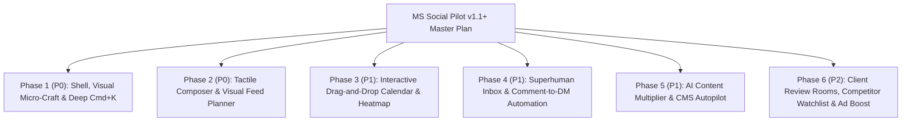

# PLAN.md — Product, Design & UX Master Plan (`v1.1+`)

Actionable, file-anchored product and design roadmap for **MS Social Pilot**, combining best-in-class patterns from **Linear**, **Raycast**, **Buffer**, **Later**, **Typefully**, **Superhuman**, **Sprout Social**, **Metricool**, **Publer**, and **Planable**.

> **For AI Agents**: Each phase below is self-contained and lists the exact target files, UI components, and acceptance criteria so you can implement any phase cleanly without breaking existing workflows.

---

## Roadmap Overview

---

## Phase 1 (P0) — Shell, Visual Micro-Craft & Deep `Cmd+K`
*Inspired by Linear, Raycast & Vercel*

### Target Files
- `app/src/styles/tokens.css`
- `app/src/styles/shell.css`
- `app/src/styles/components.css`
- `app/src/components/AppShell.tsx`
- `app/src/components/CommandPalette.tsx`

### Implementation Checklist
- [ ] **1.1 Translucent Glassmorphic Chrome (`tokens.css`, `shell.css`)**:
  - Add `--surface-glass: color-mix(in srgb, var(--surface) 84%, transparent)` and `--backdrop-blur: blur(14px) saturate(1.5)`.
  - Apply translucent sticky headers to `.shell-topbar`, calendar sticky headers, and floating bulk-action bars with `1px solid var(--line-subtle)` borders.
- [ ] **1.2 Brand Accent Tokens & Specular Cards (`tokens.css`, `components.css`)**:
  - Add authentic light/dark brand color tokens for Facebook, Instagram, YouTube, TikTok, Pinterest, LinkedIn, X, and Threads.
  - Add subtle `-1px` hover lift and specular border highlights on interactive KPI cards and channel pills.
- [ ] **1.3 Inline 48px SVG Sparklines & Semantic Delta Pills (`components.css`)**:
  - Create a reusable `<Sparkline data={number[]} />` SVG component and `<DeltaBadge value={number} />` (`+18.4% ▲` emerald / `-3.1% ▼` rose) with `font-variant-numeric: tabular-nums`.
- [ ] **1.4 Geometry-Matched Shimmer Skeletons (`components.css`)**:
  - Replace plain loading text with layout-exact `.skeleton-shimmer` placeholders for Calendar grids, Inbox threads, and Insights cards.
- [ ] **1.5 Deep Actionable `Cmd+K` Command Palette (`CommandPalette.tsx`)**:
  - Add instant zero-navigation commands: *Create Post for [Channel]*, *Switch Theme (Light/Dark)*, *Switch Language (EN/FR)*, *Collapse/Expand Sidebar (`[`)*, *Run WordPress Recipe Planner*, and *Jump to Unresolved Inbox*.

---

## Phase 2 (P0) — Tactile Composer & Visual Feed Planner
*Inspired by Buffer, Later & Typefully*

### Target Files
- `app/src/app/(workspace)/content/post/ComposerWorkspace.tsx`
- `app/src/app/(workspace)/content/post/PostPreview.tsx`
- `app/src/modules/media/ui/MediaLibrary.tsx`

### Implementation Checklist
- [ ] **2.1 Pixel-Accurate Device Frame Previews (`PostPreview.tsx`)**:
  - Render realistic mobile/desktop preview cards for **Facebook Feed/Reels**, **Instagram Feed/Carousel/Stories/Reels**, **YouTube Shorts**, **TikTok**, **LinkedIn**, and **X/Threads**.
  - Show live `...more` text-truncation fold lines, hashtag count meters (e.g., `5 / 30`), and a visual preview of the scheduled **First Comment** (`+15m delay` badge) directly beneath the post card.
- [ ] **2.2 Drag-to-Reorder Carousel & Aspect-Ratio Guardrails (`ComposerWorkspace.tsx`)**:
  - Allow drag-and-drop reordering of multi-image uploads with ordinal badges (`1`, `2`, `3`) and live aspect-ratio badges (`4:5`, `9:16`, `1:1`) that warn before publishing if an image violates network constraints.
- [ ] **2.3 Instagram & TikTok 9-Grid Visual Planner (`ComposerWorkspace.tsx`)**:
  - Add a **Grid Preview** tab showing how upcoming scheduled posts will appear arranged in a 3×3 profile grid alongside already-published posts.
- [ ] **2.4 In-Browser Image Cropper & Watermark Preview (`MediaLibrary.tsx`)**:
  - Add non-destructive aspect-ratio crop presets (`1:1`, `4:5`, `9:16`, `1.91:1`), live workspace watermark preview (`workspace_watermarks`), and custom video cover frame selection.

---

## Phase 3 (P1) — Interactive Drag-and-Drop Calendar & Heatmap
*Inspired by Sprout Social & Metricool*

### Target Files
- `app/src/app/(workspace)/content/calendar/CalendarWorkspace.tsx`
- `app/src/modules/publishing/server/lifecycle.ts`

### Implementation Checklist
- [ ] **3.1 Slot-to-Slot Drag Rescheduling (`CalendarWorkspace.tsx`)**:
  - Enable HTML5 / pointer drag-and-drop on scheduled post cards across days and hour slots in Month, Week, and Day views.
  - Perform optimistic UI updates with a 5-second **Undo** toast that calls the reschedule endpoint.
- [ ] **3.2 Best-Time Engagement Heatmap Overlay (`CalendarWorkspace.tsx`)**:
  - Add a **Heatmap Toggle** that shades calendar hour slots based on historical audience activity (`bestTimes`) so users can drop posts directly into high-engagement windows.
- [ ] **3.3 Click-to-Peek Post Approval & Quick-Edit Popover (`CalendarWorkspace.tsx`)**:
  - Clicking any calendar card opens a rich popover showing full media, caption, first comment, per-channel status, and 1-click **Approve**, **Duplicate**, **Reschedule**, or **Edit** actions without leaving the calendar.
- [ ] **3.4 Hover `+ Schedule` on Empty Slots (`CalendarWorkspace.tsx`)**:
  - Hovering any empty day/hour cell reveals a subtle `+` button that opens the Composer pre-filled with that exact date and time.

---

## Phase 4 (P1) — Superhuman Inbox & Comment-to-DM Automation
*Inspired by Superhuman, Sprout Social & ManyChat*

### Target Files
- `app/src/app/(workspace)/inbox/InboxWorkspace.tsx`
- `app/src/modules/inbox/server/`

### Implementation Checklist
- [ ] **4.1 Single-Key Triage Shortcuts (`InboxWorkspace.tsx`)**:
  - `j` / `k` — Next / previous conversation or comment thread.
  - `e` — Mark resolved and auto-advance to the next unread thread.
  - `r` — Focus reply composer.
  - `a` — Assign thread to a teammate.
  - `/` — Open saved-reply snippet picker with dynamic variables (`{{author_name}}`, `{{channel_name}}`).
  - `?` — Open keyboard shortcut cheat-sheet modal.
- [ ] **4.2 Pinned Parent Post Context & Audience Mini-CRM (`InboxWorkspace.tsx`)**:
  - Pin a collapsible card at the top of comment threads showing the parent post's thumbnail, caption, permalink, and reaction counts.
  - Show commenter history (past comments, sentiment badge, repeat-engager VIP badge) in a right-hand drawer.
- [ ] **4.3 1-Click AI Reply Tone Chips (`InboxWorkspace.tsx`)**:
  - Add instant AI draft chips above the reply box: *Friendly*, *Supportive*, *Answer FAQ*, *Translate EN/FR*, *De-escalate*.
- [ ] **4.4 Keyword Comment-to-DM Automation (`src/modules/inbox/server/`)**:
  - When a user comments a trigger keyword (e.g., `"RECIPE"`, `"LINK"`, `"GUIDE"`) on a Facebook or Instagram post, automatically like the comment, post a public reply variation, and send a private DM with the link or recipe card.

---

## Phase 5 (P1) — AI Content Multiplier & CMS Autopilot
*Inspired by Typefully & Publer*

### Target Files
- `app/src/modules/studio/`
- `app/src/modules/feeds/wordpress/`
- `app/src/modules/feeds/ui/RecipeSource.tsx`

### Implementation Checklist
- [ ] **5.1 1-to-Many Smart Content Multiplier (`/content/ai-studio`)**:
  - Paste any WordPress URL, blog article, or recipe and generate a coordinated multi-network campaign in one click (Instagram 5-slide carousel + Reel script, Facebook post + delayed recipe first comment, LinkedIn post, X/Threads thread, TikTok hook).
- [ ] **5.2 AI Hook & Virality Scorer (`ComposerWorkspace.tsx`)**:
  - Score draft hooks (0–100) for curiosity, clarity, and platform fit, and suggest 3 punchier alternatives inline.
- [ ] **5.3 Universal CMS & Schema.org Adapter (`src/modules/feeds/`)**:
  - Extend the WordPress REST planner UI with a 1-click **Test Connection & Inspect Fields** button that previews detected REST post types, custom meta keys, and Schema.org `Recipe` / `Article` fields live.
- [ ] **5.4 Evergreen Outperformer Booster (`src/modules/publishing/`)**:
  - Automatically flag published posts that beat the workspace's 90th-percentile engagement rate within 48 hours and offer 1-click evergreen recycling with AI-refreshed captions.

---

## Phase 6 (P2) — Client Review Rooms, Competitor Watchlist & Ad Boost
*Inspired by Planable, Metricool & Hootsuite*

### Target Files
- `app/src/modules/sharing/`
- `app/src/modules/agency/`
- `app/src/modules/ads/`
- `app/src/app/(workspace)/insights/`

### Implementation Checklist
- [ ] **6.1 Passwordless Magic-Link Client Approval Rooms (`/share/[token]`)**:
  - Allow agency clients to view upcoming scheduled posts in realistic feed/calendar views via an expiring magic link and click **Approve** or **Request Changes** with timestamped feedback—no login required.
- [ ] **6.2 Cross-Filtered Insights & Competitor Watchlist (`/insights`)**:
  - Clicking any bar on the ECharts timeline filters the Top Posts table below to that exact date window.
  - Benchmark public follower growth, posting frequency, and engagement rates against up to 10 watched competitor pages.
- [ ] **6.3 Organic-to-Paid Meta Ad Auto-Boost (`/ads`)**:
  - Suggest or automatically trigger a `$10–$50` Meta Ad boost when an organic Facebook/Instagram post crosses an engagement velocity threshold, plus interactive Campaign → Ad Set → Ad breadcrumb drilldowns in `/ads/manage`.
