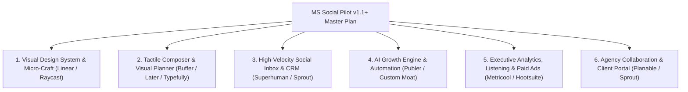

# PLAN.md — Product, Design & UX Master Plan (`v1.1+`)

Comprehensive product and design evolution roadmap for **MS Social Pilot**, combining best-in-class patterns from **Buffer**, **Sprout Social**, **Hootsuite**, **Later**, **Typefully**, **Metricool**, **Publer**, **Linear**, **Raycast**, and **Superhuman** with AI-native workflows.

---

## Architecture of the Master Plan

---

## 1. Visual Design System & Micro-Craft *(Inspired by Linear, Raycast & Vercel)*

### 1.1 Layered Glassmorphism & Specular Depth (`app/src/styles/tokens.css`, `shell.css`)
- **Translucent Floating Chrome**: Apply `backdrop-filter: blur(14px) saturate(1.5)` and `color-mix(in srgb, var(--surface) 84%, transparent)` to sticky topbars, calendar headers, and floating bulk-action toolbars so scrolling content glides cleanly beneath.
- **1px Specular Borders & Subtle Elevation**: Use hairlines (`1px solid var(--line-subtle)`) paired with soft multi-layer shadows (`--shadow-card`) and a `-1px` hover lift on interactive KPI cards, post tiles, and channel pills.
- **Authentic Network Brand Accents**: Tint platform badges, composer tabs, and chart series with balanced light/dark brand tokens (Facebook Blue, Instagram Magenta/Sunset, YouTube Red, TikTok Cyan/Rose, LinkedIn Blue, X Monochrome, Threads, Pinterest).

### 1.2 Data-Dense Typography & Inline Visuals (`app/src/styles/components.css`)
- **Tabular Numerals Everywhere**: Enforce `font-variant-numeric: tabular-nums` across all metrics, counters, timers, and currency columns.
- **Inline 48px SVG Sparklines & Sparkbars**: Embed mini trend sparklines and proportional fill bars directly inside Analytics, Top Posts, and Ads tables so users spot outliers before reading digits.
- **Semantic Delta Pills**: Standardize period-over-period badges (`+18.4% ▲` in emerald tint, `-3.1% ▼` in amber/rose tint) with hover tooltips showing exact prior-period values.

### 1.3 Spring Choreography & Geometry-Matched Skeletons
- **Spring Physics (`cubic-bezier(0.22, 1, 0.36, 1)`)**: Smooth `180ms` transitions on sidebar rail collapse (`[`), drawers, popovers, and active tab indicators.
- **Zero-Spinner Shimmer Skeletons**: Replace loading text with layout-exact shimmer skeletons for the Calendar grid, Inbox split pane, and Insights charts.

---

## 2. Tactile Composer & Visual Planner *(Inspired by Buffer, Later & Typefully)*

### 2.1 Live Multi-Network Device Frame Previews (`/content/post`)
- **Pixel-Accurate Network Frames**: Side-by-side live previews simulating mobile/desktop cards for Facebook Feed/Reels, Instagram Feed/Carousel/Stories/Reels, X/Threads multi-post threads, LinkedIn posts, YouTube Shorts, and TikTok vertical video.
- **Live Character Fold & Hashtag Meter**: Highlight where each network truncates text (`...more` fold line), count hashtags/mentions against network limits, and warn on link-preview suppression.
- **First-Comment Timeline Preview**: Render the scheduled first comment (and its delay badge, e.g. `+15m after publish`) directly below the simulated post card.

### 2.2 Visual Grid Planner & Drag-and-Drop Media Studio (`/content/post`, `/content/media`)
- **Instagram & TikTok 9-Grid Visual Feed Preview *(Later-style)***: Preview how upcoming scheduled posts will look arranged in a 3×3 profile grid alongside already-published posts, with drag-and-drop grid reordering.
- **Drag-to-Reorder Carousel Thumbnails**: Reorder multi-photo uploads via drag-and-drop with live ordinal badges (`1`, `2`, `3`) and instant aspect-ratio warnings (`4:5`, `9:16`, `1.91:1`).
- **Built-In Canvas Cropper & Brand Watermark Studio**: Non-destructive aspect-ratio presets, one-click workspace brand watermark/frame stamping, custom video cover frame picker, and automatic EN/FR subtitle (`.srt`) generation.

### 2.3 Interactive Drag-and-Drop Calendar (`/content/calendar`)
- **Slot-to-Slot Drag Rescheduling**: Drag scheduled post cards across days, hours, or channel swimlanes in Month, Week, and Day views with optimistic updates and a 5-second undo toast.
- **Best-Time Heatmap Overlay *(Sprout/Metricool-style)***: Shade calendar time slots by historical audience engagement intensity so creators drop posts into dark-tinted peak slots effortlessly.
- **Click-to-Peek Post Popover**: Click any calendar card to view full media, per-channel publish status, approval stage, and team comments—and **Approve**, **Duplicate**, or **Reschedule** without leaving the calendar.

---

## 3. High-Velocity Social Inbox & Audience CRM *(Inspired by Superhuman & Sprout Social)*

### 3.1 Keyboard-First Triage (`/inbox`)
- **Single-Key Triage Flow**:
  - `j` / `k` — Next / previous thread
  - `e` — Resolve thread and auto-advance to the next unread item
  - `r` — Focus reply composer
  - `a` — Assign to team member
  - `/` — Open saved-reply snippet & variable menu (`{{author_name}}`, `{{channel_name}}`)
  - `?` — Keyboard shortcut cheat sheet modal
- **Pinned Parent Post Context Card**: Keep a collapsible card at the top of comment threads displaying the parent post's thumbnail, caption, publish date, and live reactions.

### 3.2 Comment-to-DM Automation Recipes *(ManyChat / Publer-style)*
- **Keyword Trigger Flows**: When a user comments a trigger keyword (e.g. `"RECIPE"`, `"GUIDE"`, `"LINK"`, `"PRICE"`) on a Facebook or Instagram post, automatically:
  1. Like and reply publicly with a rotating friendly variation.
  2. Send a private DM containing the link, recipe card, or offer code.
- **Audience Mini-CRM & VIP Badges**: Display commenter interaction history (past comments, sentiment score, VIP/repeat-engager badge) in a right-hand contact drawer.
- **1-Click AI Reply Tone Chips**: Instant reply drafts above the composer (*Friendly*, *Supportive*, *Answer FAQ*, *Translate EN/FR*, *De-escalate*).

---

## 4. AI Growth Engine & Content Repurposing *(Inspired by Typefully & Publer)*

### 4.1 1-to-Many Smart Content Multiplier (`/content/ai-studio`, `/content/post`)
- **URL / Article / Recipe to Multi-Channel Campaign**: Paste a blog URL, YouTube link, or WordPress recipe and generate a complete cross-channel campaign in one click:
  - Instagram 5-slide visual carousel + Reel script
  - Facebook conversational post + delayed recipe first comment
  - X / Threads numbered thread with hook variants
  - LinkedIn executive post
  - TikTok / Shorts spoken hook + caption
- **AI Hook & Virality Scorer**: Score draft hooks (0–100) for curiosity, clarity, and platform fit, offering 3 punchier alternatives before scheduling.

### 4.2 "Fill My Week" Calendar Autopilot & Evergreen Booster (`/content/calendar`, `/content/agents`)
- **1-Click Weekly Schedule Generator**: Analyze `bestTimes`, WordPress/RSS recipe pools, and content pillars to auto-populate empty calendar slots for the next 7 days in a single reviewable batch.
- **Evergreen Auto-Detector**: Flag published posts that beat the workspace's 90th-percentile engagement rate within 48 hours and offer 1-click recycling with AI-refreshed captions.

---

## 5. Executive Analytics, Competitor Listening & Paid Ads *(Inspired by Metricool & Hootsuite)*

### 5.1 Cross-Filtered Insights & Competitor Watchlist (`/insights`)
- **Click-to-Filter Interactive Timeline**: Clicking any day or week bar on the ECharts timeline filters the Top Posts and Channel Breakdown tables below to that exact window.
- **Competitor Benchmark Watchlist**: Track public follower growth, posting cadence, format mix, and engagement rates for up to 10 competitor pages side-by-side with your own channels.
- **Smart UTM Builder & Revenue Attribution**: Auto-append `utm_source`, `utm_medium`, and `utm_campaign` to links in Composer and track link clicks through to conversions.

### 5.2 Paid + Organic Synergy & Ads Funnel (`/ads`)
- **Auto-Boost High Performers**: Automatically suggest (or trigger via rule) a `$10–$50` Meta Ad boost when an organic Facebook/Instagram post crosses an engagement velocity threshold.
- **Campaign -> Ad Set -> Ad Breadcrumb Drilldown**: Click a Campaign row in `/ads/manage` to filter Ad Sets and Ads with a dismissible breadcrumb pill, paired with visual spend/CTR sparkbars and creative fatigue warnings.

---

## 6. Agency Collaboration & Client Portal *(Inspired by Planable & Sprout)*

### 6.1 Passwordless Magic-Link Client Review Rooms (`/sharing`, `/agency`)
- **White-Label External Review Portal**: Generate expiring, brand-customized magic links where external agency clients inspect upcoming posts in realistic feed/calendar views and click **Approve** or **Request Changes** with timestamped comments—no login required.
- **Executive White-Label PDF & Live Report Links**: 1-click agency-branded monthly performance decks with custom executive summaries written by AI and editable chart annotations.

---

## Prioritized Implementation Roadmap

| Phase | Focus | Key Deliverables | Target Files |
| :--- | :--- | :--- | :--- |
| **Phase 1 (P0)** | **Shell, Design Polish & Deep `Cmd+K`** | Glassmorphic topbar/bars, inline sparklines/delta pills, shimmer skeletons, and zero-nav `Cmd+K` quick actions (theme/rail/channel jumps) | `src/styles/*`, `AppShell.tsx`, `CommandPalette.tsx` |
| **Phase 2 (P0)** | **Tactile Composer & Visual Grid** | Side-by-side device frames, fold/hashtag meters, drag-to-reorder carousel, 9-grid Instagram preview, and in-browser image cropper | `ComposerWorkspace.tsx`, `PostPreview.tsx`, `media/ui/*` |
| **Phase 3 (P1)** | **Interactive Calendar & Quick-Peek** | Drag-and-drop slot rescheduling, best-time heatmap tinting, click-to-peek approval popover, and empty-slot `+ Schedule` button | `CalendarWorkspace.tsx` |
| **Phase 4 (P1)** | **Superhuman Inbox & Comment-to-DM** | Keyboard triage (`j`/`k`/`e`/`r`/`/`), pinned parent post card, 1-click AI tone chips, and keyword Comment-to-DM automation rules | `InboxWorkspace.tsx`, `inbox/server/*` |
| **Phase 5 (P1)** | **AI Multiplier & "Fill My Week"** | 1-to-many cross-network repurposing engine, AI hook scorer, evergreen auto-detector, and 1-click weekly calendar autopilot | `studio/*`, `publishing/*` |
| **Phase 6 (P2)** | **Client Portal, Competitors & Ad Boost** | Passwordless client approval rooms, competitor watchlist, auto-UTM builder, and organic-to-paid ad boost rules | `sharing/*`, `agency/*`, `insights/*`, `ads/*` |
