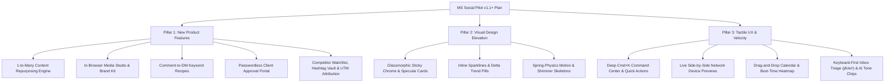

# PLAN.md — Feature, Design & UX Roadmap (`v1.1+`)

Actionable roadmap for **MS Social Pilot** covering **New Product Features**, **Visual Design System Elevation**, and **UX Workflow Velocity**.

---

## Overview

---

## Pillar 1: New Product Features

### 1.1 Smart 1-to-Many Content Repurposing (`/content/composer` & `/content/ai-studio`)
- **Cross-Network Multiplier**: Transform a single post, blog URL, or WordPress recipe into tailored formats for every selected channel in one click:
  - **Instagram**: 5-slide carousel outline + Reel hook/caption + ranked hashtags.
  - **Facebook Page**: Conversational post + delayed first-comment recipe/link.
  - **X / Threads**: Numbered multi-post thread with character-safe splits.
  - **LinkedIn**: Executive summary with bulleted takeaways.
  - **TikTok / Shorts**: 30-second spoken hook + visual B-roll cues.
- **Evergreen Score & Auto-Recycle Booster**: Score published posts by 48-hour engagement velocity and offer 1-click promotion to the Evergreen Queue with 3 AI-rewritten caption variants.

### 1.2 Built-In Visual Media Studio & Brand Kit (`/content/media`)
- **In-Browser Aspect-Ratio Cropper**: Non-destructive cropping (`1:1`, `4:5`, `9:16`, `16:9`) inside Composer and Media Library.
- **Workspace Brand Kit Overlays**: Stamp workspace logos, watermarks, brand frames, and typography presets onto uploaded or AI-generated images.
- **Video Cover Picker & Bilingual Subtitles**: Select custom video thumbnails and auto-generate EN/FR SRT captions.

### 1.3 Automated Comment-to-DM Engagement Recipes (`/inbox`)
- **Keyword Trigger Flows**: When a follower comments a keyword (e.g., `"RECIPE"`, `"LINK"`, `"GUIDE"`), automatically reply publicly with a rotating friendly variation and send a private DM containing the link or offer.
- **VIP Tagging & Sentiment Escalation**: Auto-tag repeat/high-reach commenters as `VIP` and route negative-sentiment threads to a priority triage view with Slack/Telegram alerts.

### 1.4 Passwordless Client Approval Portal (`/sharing` & `/agency`)
- **External Magic-Link Review Rooms**: Share expiring, brand-customized links where agency clients preview scheduled posts and click **Approve** or **Request Changes** without needing a workspace login.

### 1.5 Competitor Benchmarks, Hashtag Vault & UTM Attribution (`/insights` & `/ads`)
- **Competitor Watchlist**: Track public follower growth, posting frequency, and engagement rates for up to 10 competitor pages.
- **Hashtag & Snippet Vault**: Save reusable hashtag groups and CTA blocks with live engagement scoring in Composer.
- **Automatic UTM Builder & Funnel Attribution**: Auto-append `utm_source`, `utm_medium`, and `utm_campaign` parameters and track organic-vs-paid conversion efficiency.

### 1.6 "Fill My Week" AI Calendar Autopilot (`/content/calendar`)
- **1-Click Weekly Schedule Generator**: Combine workspace `bestTimes`, WordPress recipe pools, and evergreen templates to fill empty calendar slots for the next 7 days in a single reviewable batch.

---

## Pillar 2: Visual Design System Elevation

### 2.1 Glassmorphic Chrome & Specular Depth (`app/src/styles/tokens.css`, `shell.css`)
- **Translucent Sticky Bars**: Apply `backdrop-filter: blur(12px) saturate(1.4)` and `color-mix(in srgb, var(--surface) 86%, transparent)` to sticky topbars, filter headers, and floating bulk-action bars.
- **Micro-Elevation & Brand Tints**: Subtle `1px` specular borders, `translateY(-1px)` card hover lift, and authentic network brand color accents balanced across all 8 light/dark palettes.

### 2.2 Data-Dense Cards & Inline Sparklines (`app/src/styles/components.css`)
- **Tabular Numerals & Trend Pills**: Pair `font-variant-numeric: tabular-nums` with semantic delta badges (`+18.4% ▲` in `--success-soft`, `-3.1% ▼` in `--warning-soft`).
- **Inline Sparkbars & 48px SVG Sparklines**: Embed visual progress bars and mini trend lines inside Analytics and Ads tables for instant visual scanning.

### 2.3 Motion Choreography & Shimmer Skeletons
- **Spring Transitions**: `cubic-bezier(0.22, 1, 0.36, 1)` (`180ms`) for drawers, popovers, and tab indicators.
- **Geometry-Matched Skeletons**: Shimmer placeholders matching KPI cards, calendar cells, and inbox rows during data fetches.

---

## Pillar 3: Tactile UX & Workflow Velocity

### 3.1 Deep `Cmd+K` Command Center (`app/src/components/CommandPalette.tsx`)
- **Multi-Entity Search**: Search routes, channels, recent drafts, scheduled posts, saved inbox views, and ad campaigns.
- **Zero-Navigation Quick Actions**: Switch theme/palette, toggle the `64px` sidebar icon rail (`[`), filter by channel, or jump to unread mentions directly from `Cmd+K`.

### 3.2 Tactile Multi-Channel Composer (`app/src/modules/publishing/ui/ComposerWorkspace.tsx`)
- **Live Side-by-Side Network Previews**: Real-time mobile/desktop device frames showing exact character fold cutoffs (`...more`), aspect-ratio crops, carousel dots, and delayed first-comment timeline previews (`+15m`).
- **Drag-to-Reorder Media Grid**: Drag thumbnails to reorder carousels with live ordinal badges (`1`, `2`, `3`) and aspect-ratio warnings.

### 3.3 Interactive Calendar & Swimlanes (`app/src/modules/publishing/ui/CalendarWorkspace.tsx`)
- **Drag-and-Drop Slot Rescheduling**: Drag post cards across days and hours in Month, Week, and Channel Swimlane views with optimistic updates and 5-second undo toasts.
- **Click-to-Peek Popover & Best-Time Heatmap**: Inspect media, approve/reject, or comment in a floating popover without leaving the calendar; toggle high-engagement hour tinting.

### 3.4 Split-Pane Inbox Keyboard Triage (`app/src/modules/inbox/ui/InboxWorkspace.tsx`)
- **Single-Key Triage**: `j`/`k` next/prev thread, `e` resolve & advance, `r` reply, `a` assign, `/` saved reply slash menu, and `?` shortcut cheat sheet.
- **Pinned Parent Post Context & AI Tone Chips**: Display the parent published post card at the top of comment threads and offer 1-click AI reply chips (*Friendly*, *Supportive*, *FAQ*, *Translate EN/FR*).

---

## Phased Execution Matrix

| Phase | Deliverables | Primary Targets | Priority |
| :--- | :--- | :--- | :---: |
| **Phase 1** | Deep `Cmd+K` Quick Actions + Glassmorphic Chrome + Shimmer Skeletons | `AppShell.tsx`, `CommandPalette.tsx`, `src/styles/*` | **P0** |
| **Phase 2** | Live Device Previews + Drag-to-Reorder Carousel + In-Browser Media Cropper | `ComposerWorkspace.tsx`, `PostPreview.tsx`, `media/ui/*` | **P0** |
| **Phase 3** | Drag-and-Drop Calendar + Best-Time Heatmap + Click-to-Peek Popover | `CalendarWorkspace.tsx` | **P1** |
| **Phase 4** | Inbox Keyboard Triage (`j`/`k`/`e`/`r`/`/`) + Parent Post Card + AI Tone Chips | `InboxWorkspace.tsx` | **P1** |
| **Phase 5** | 1-to-Many Content Repurposing + "Fill My Week" Calendar Autopilot | `studio/*`, `publishing/*` | **P1** |
| **Phase 6** | Comment-to-DM Recipes + Magic-Link Client Portal + Competitor Watchlist & UTMs | `inbox/*`, `sharing/*`, `insights/*`, `ads/*` | **P2** |
