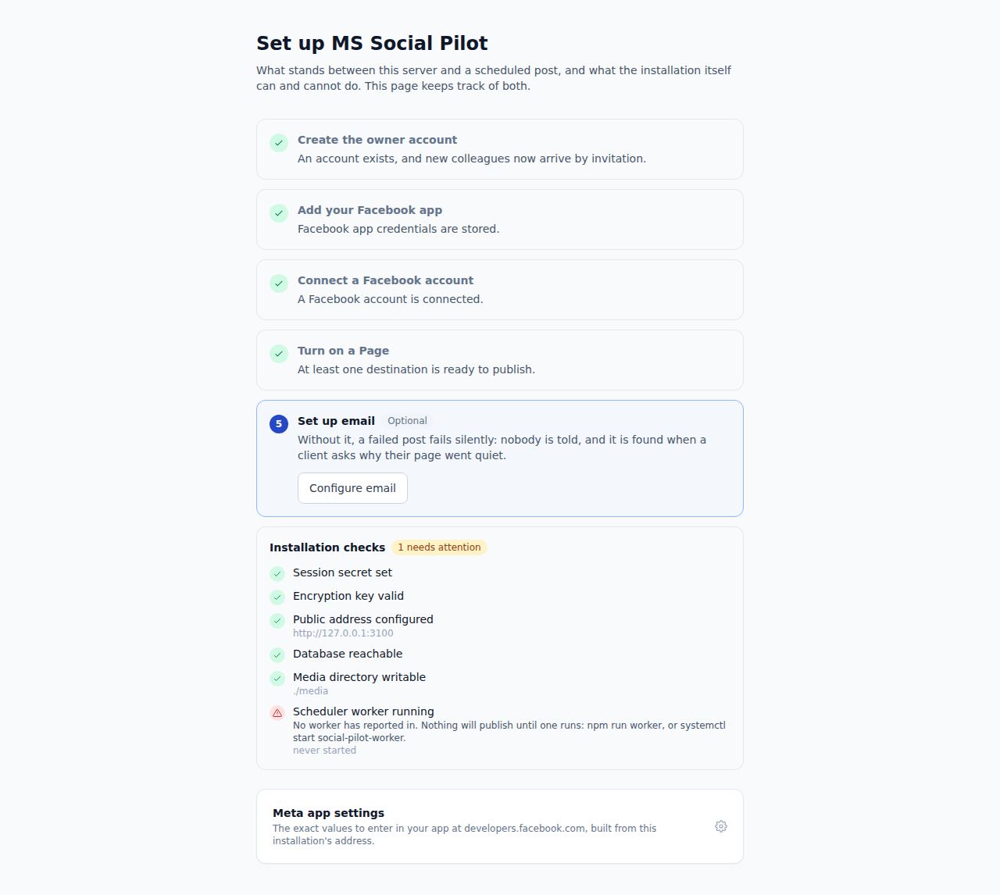
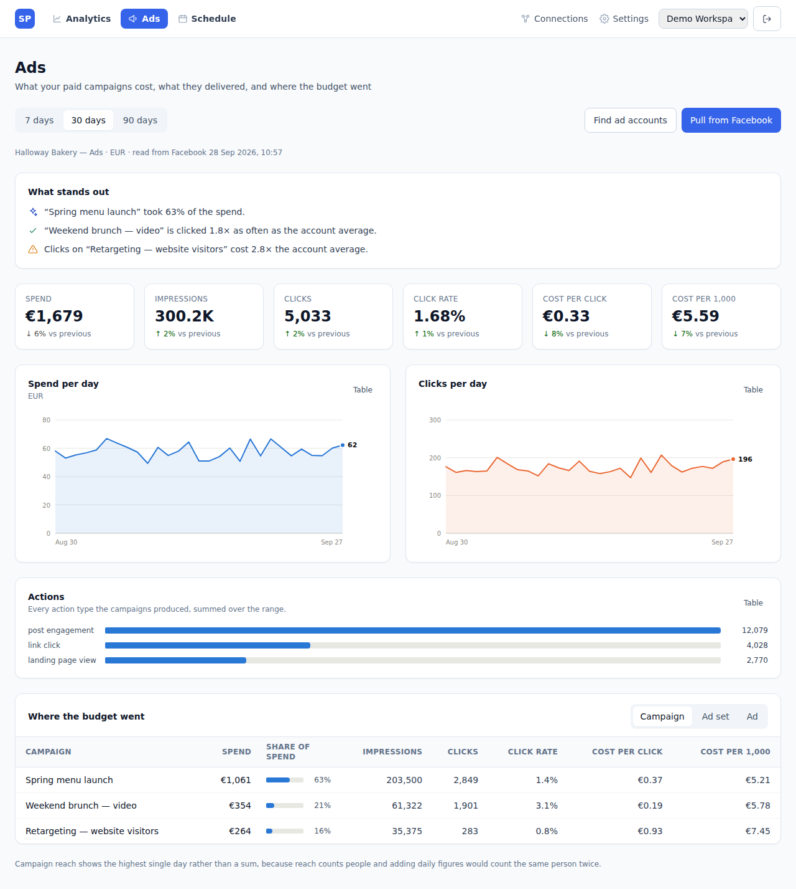
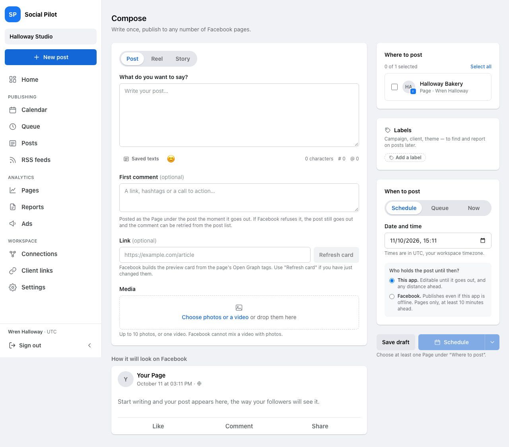
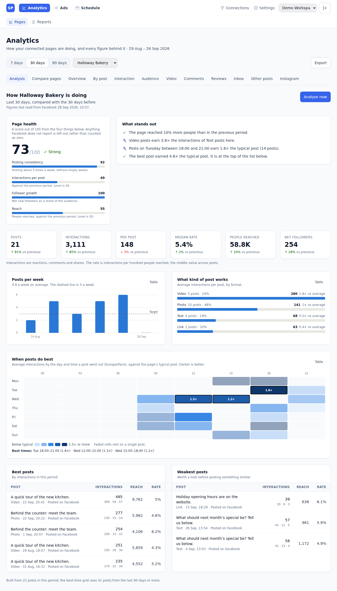
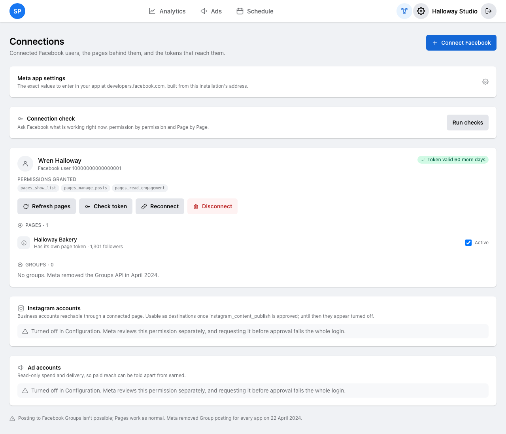

# MS Social Pilot 1.0.0

A SocialPilot-style scheduler for Facebook Pages and Instagram. Compose
once, publish to many destinations, with an approval workflow, RSS auto-posting,
AI writing help, link tracking and client reporting.

Next.js 15 (App Router), TypeScript, Prisma, PostgreSQL, Tailwind. English and
French.

### Where to start

| If you want to | Read |
|---|---|
| Run it locally, right now | [Quick start](#quick-start), below |
| Connect it to Facebook | [docs/META_APP_SETUP.md](docs/META_APP_SETUP.md) — the part that blocks people |
| Put it on a server | [docs/DEPLOYMENT.md](docs/DEPLOYMENT.md) |
| Understand how it works | [docs/ARCHITECTURE.md](docs/ARCHITECTURE.md) |
| Know what it was built to be | [docs/PROJECT_SCHEMA.md](docs/PROJECT_SCHEMA.md) |
| Run the browser tests | [e2e/README.md](e2e/README.md) |
| Work on it as an AI agent (Claude) | [CLAUDE.md](CLAUDE.md) and [docs/ai/](docs/ai/README.md) |

The app also explains itself as you go: a fresh installation opens on a **Setup**
screen that says what is done, what is next, and what the installation itself
cannot do — including the commonest first-install mistake, a scheduler worker
nobody started.



---

## What it does

The app is three modules, one tab each in the top bar:

| Module | What it answers | Screens |
|---|---|---|
| **Analytics** | How are my Pages doing, and why? | Page analysis, compare pages, every insights view, reports |
| **Ads** | What did the paid side cost, and what did it buy? | Spend and delivery against the previous period, daily trends, campaign / ad set / ad breakdown |
| **Schedule** | What is going out, and when? | Calendar, posts, composer, approvals, RSS feeds |

Connections, settings and the home overview serve all three and sit beside
them rather than in any one.





**Publishing**
- Many Facebook Pages from one composer: text, links, photo
  galleries, video.
- **Instagram Business accounts** as destinations alongside them — single
  photo, reel, or carousel. Instagram's API takes a URL rather than an upload,
  so each attachment gets a signed link that names one file and expires in
  minutes; nothing in the media library becomes publicly readable.
- Per-destination outcomes. Publishing to five Pages where one token is dead
  succeeds on four and reports the fifth, rather than failing the batch.

**Scheduling** — three modes, because they fail differently:

| Mode | Who holds the post | Editable after saving | How far ahead | Survives your server being down |
|---|---|---|---|---|
| Publish now | — | n/a | — | n/a |
| Scheduled (default) | This app | Yes | Any time | No — the worker must be running |
| Scheduled (native) | Facebook | No, cancel and recreate | 10 minutes to 30 days | Yes |

- A recurring **queue** ("post at my next free slot"), defined in workspace-local
  time and stable across daylight saving changes.
- Calendar view, bulk CSV scheduling, and **evergreen recycling** that rotates
  text variants so Facebook does not reject repeats as duplicates.
- Anything not yet sent can be **edited in place** — wording, attachments,
  destinations, time — in the composer it was written in. A post held for review
  goes back to the reviewer only if the edit changes what they looked at.

**Teams and clients**
- Several clients per account, each its own workspace with its own
  destinations, queue, branding and language.
- Roles: owner, admin, editor, contributor. Email invitations with hashed,
  expiring tokens. Nobody can grant, or take away, a role above their own — an
  admin cannot make themselves an owner and inherit the instance settings.
- **Approval workflow**: contributors submit, admins approve or send back with a
  note. Enforced in the scheduler, not just the UI. Contributors upload media —
  they draft posts — but deleting from the shared library is editor and above.
- **Your own account** under Settings → Account: change your name, language and
  password, and sign out every other device. Changing the password signs the
  other devices out as well.

**Automation**
- **RSS auto-posting** with conditional polling, guid de-duplication, and a
  first-poll cutoff so subscribing to a blog does not queue its archive.
  Facebook destinations only: a feed item is a headline and a link, and
  Instagram publishes neither without a picture.
- **AI captions** via the Claude API, seeded by the workspace's brand voice.
- **Link shortener + UTM tagging** applied at publish time, per destination.

**Reliability**
- Retries with exponential backoff and jitter; rate limits back off much harder
  than transient errors.
- Failures that cannot succeed on retry — revoked token, missing permission,
  content Facebook rejected — fail immediately with an explanation.
- Email alerts on publish failure, dead connections, and tokens **approaching**
  expiry.
- Crashed workers release their locks; several workers can run safely.

**Engagement** — comments moderated from here (reply, hide, delete, each
writing to Facebook first), searchable and filterable by whether they are
hidden, because a busy Page has more comments than anybody scrolls. Page
ratings, and the Page inbox with replies.
Facebook accepts a reply only within 24 hours of the person's last message, so
threads outside that window say so instead of offering a box that would refuse.

**Open Graph link previews** — Facebook's own scraper
(`POST /?id=<url>&scrape=true`), so you see exactly the card Facebook will
render and its cache is refreshed. Falls back to parsing `og:` tags directly.

**Page analysis** — the first thing Analytics shows for a connected Page is
what its numbers *mean*: a health score out of 100 built from four stated
parts, this period against the one before, posts per week against a target,
which formats earn the most interactions, a day-by-time grid of when posts do
best, the strongest and weakest posts, and a short list of findings in plain
sentences. It reads every post on the Page, not only those published from here,
and compares the Page with itself rather than with benchmarks nobody can check.
**Compare pages** puts every Page in a workspace side by side on the same
figures. **Analyse now** re-reads the Page from Facebook on demand.



**Reporting** — impressions, reach, engagement and link clicks per destination
and per post, with CSV export and a print-styled page for PDF.

**Media library** — everything uploaded for a client, what each file is still
holding up, and how much of the storage allowance is gone. A file a scheduled
post still needs cannot be deleted, and the screen links to the posts using it.

**History** — who did what, in sentences rather than event names, and every
email the app tried to send. Email failures are silent by design, so the screen
says how many there were rather than waiting to be asked. Owner and admin only:
it names people, and for a deleted comment it holds the only copy of what was
deleted, because Facebook keeps none.

---

## Quick start

Requires **Docker**, or **Node 20.11+** (22 recommended) with **PostgreSQL 14+**.

```bash
npm install
npm run setup
```

`npm run setup` writes `.env` from `.env.example` and generates the secrets that
must be unique to your installation — the session signing key, the token
encryption key and the password of the bundled Postgres, which Docker Compose
refuses to start without. It never overwrites values you have already set, so it
is safe to run again.

Then, with Docker:

```bash
docker compose up -d
```

That is Postgres, the web app and the scheduler worker, on
<http://localhost>. The app applies its own migrations on first boot.

Port 80 is the default because a real deployment sits behind Cloudflare or
another terminator. On a laptop where 80 is taken, or where publishing it needs
root, set `APP_PORT=8080` in `.env` and use <http://localhost:8080>.

Or without Docker, using a Postgres you already have:

The Compose Postgres is published on `127.0.0.1:5432` only, and the
`DATABASE_URL` that `npm run setup` writes already carries its password:

```bash
docker compose up -d postgres   # or point DATABASE_URL at your own
npm run db:migrate
npm run db:seed                 # optional: demo login, two workspaces
npm run db:demo                 # optional: two invented Pages with six months of analytics
npm run dev                     # http://localhost:3000
npm run dev:worker              # second terminal
```

Both processes are needed: the web app schedules, the worker publishes. A
serverless alternative to the long-running worker is `POST /api/cron/tick` —
see [docs/DEPLOYMENT.md](docs/DEPLOYMENT.md).

The app listens on `PORT` — **80 by default** — and speaks plain HTTP: HTTPS is
terminated in front of it, by Cloudflare or another proxy, so 443 is never this
process's port. Port 80 is privileged; the systemd unit written by the Debian
installer can bind it without running as root, and
[docs/DEPLOYMENT.md](docs/DEPLOYMENT.md) covers the Cloudflare setup and the
alternatives.

### Then, in the browser

Open the app — <http://localhost> under Docker, <http://localhost:3000> from
`npm run dev`, which stays on 3000 so a development server never needs root.

1. **Create the first account.** It becomes the owner. Sign-up is closed to
   everyone else until you open it or send an invitation, because this app has
   to be reachable from the internet for Facebook to call back.
2. **The Setup screen** opens by itself and asks for your Meta app ID and
   secret. It lists what is done and what is left, and it is the one screen that
   works before an owner exists — after that it is owner-only.
3. **Connect a Facebook account** from Connections. Each account shows which
   permissions were granted and whether publishing actually works, so a missing
   permission is visible here rather than at publish time.



Getting the Meta app itself right is the part that blocks people:
[docs/META_APP_SETUP.md](docs/META_APP_SETUP.md).

Everything optional degrades cleanly. No `RESEND_API_KEY` and email is logged as
skipped rather than failing; no `ANTHROPIC_API_KEY` and the composer hides the AI
tools.

---

## Terminology

Two similarly named things, both used here:

- **Graph API** — the REST API that creates posts (`POST /{page-id}/feed`).
- **Open Graph** — the `og:` metadata protocol describing a web page. Graph's
  scrape endpoint reads it to build link preview cards.

---

## The worker

Ten jobs on independent intervals, every one of them adjustable on the
configuration screen:

| Job | Default | What it does |
|---|---|---|
| `publish` | 30s | Publishes due posts |
| `edges` | 4h | Comments, ratings, inbox threads, videos, posts made outside this app |
| `rss` | 15m | Polls feeds, queues new items |
| `evergreen` | 1h | Creates the next copy of recycling posts |
| `analytics` | 6h | Refreshes post engagement, stalest first |
| `pageInsights` | 12h | Page-level reach and follower figures |
| `instagram` | 12h | Instagram profiles, insights and media — only when Instagram is on |
| `ads` | 12h | Campaign spend and results — only when Ad spend is on |
| `housekeeping` | 24h | Retention sweeps, orphaned media, expired rows |
| `tokens` | 24h | Warns before a token expires |

The two flagged jobs are not scheduled at all while their switch is off, so an
app without those permissions does not spend its rate limit on an error every
twelve hours.

A failing job never stops the others, and a slow one never laps itself — the
next run is measured from the moment the last one finished.
`POST /api/cron/tick?jobs=publish,rss` runs a chosen subset over HTTP, which is
how to drive it from a serverless cron instead of a long-running worker.

---

## Scripts

| Command | What it does |
|---|---|
| `npm run setup` | Write `.env` and generate the per-installation secrets |
| `sudo bash scripts/install-debian.sh` | Whole-server install on fresh Debian |
| `npm run screenshots` | Retake the documentation images (needs Playwright) |
| `npm run dev` / `npm run dev:worker` | Dev server / worker |
| `npm run build` / `npm start` | Production build and server |
| `npm run worker` | Worker (production) |
| `npm test` | Vitest suite |
| `npm run typecheck` | `tsc --noEmit` |
| `npm run db:migrate` / `db:push` / `db:studio` / `db:seed` | Prisma |
| `npm run db:demo` | Invented Pages with analytics history, to see the analytics screens without Facebook |

---

## Tests

```bash
npm test
```

1057 tests, in three layers.

**Unit tests** cover the pure decision-making: which Graph edge a post takes,
whether a retry is worth attempting, token encryption, timezone and queue-slot
arithmetic, Open Graph and RSS parsing, CSV in and out, link tagging, and the
rules for what Instagram will accept.

**Seventeen integration suites** run against a real Postgres schema and a stub
Graph API. They exist for the failures that cost customers rather than the ones
that annoy developers:

- **scheduler** — a post going out exactly once under concurrency, backoff on
  transient errors, a revoked token failing permanently and flagging the
  account, partial success across destinations, abandoned locks reclaimed, and
  Instagram's container-then-publish two-step.
- **approvals** — an unapproved post never publishing even when due, "publish
  now" not bypassing review, and one client's workspace unable to read, post to
  or approve anything belonging to another.
- **api-routes** — every endpoint under `src/app/api` called with no session,
  and again as a contributor. See below.
- **engagement** — comments moderated, ratings and inbox threads synced, and
  replies refused outside Facebook's 24-hour window.
- **health** — what the connection screen says, including the cases where
  saying nothing beats saying something wrong.
- plus **jobs**, **housekeeping**, **settings**, **setup**, **registration**,
  **connections**, **media**, **notify**, **send**, **ai** and **iterate**.

One of them is a sweep rather than a list, which is the point: `api-routes`
walks every file under `src/app/api`, calls each exported handler with no
session, and fails unless it refuses. A route that answers has to be named in a
`PUBLIC` map with a written reason — so a new endpoint is private until somebody
says otherwise. A second pass signs in as a contributor, the lowest role, and
checks the endpoints that act on the business rather than on their own drafts.

Tests need a reachable Postgres; each suite creates and drops its own schema.
Point `TEST_DATABASE_URL` at it if it is not the Compose default.

### The browser walk

None of the above renders a page. `e2e/` holds a Playwright pass over every
screen — in English and in French, signed in and signed out, with a post on the
calendar — that catches what only a browser can: a server component that throws,
a missing translation, a form that submits before React attaches to it.

Playwright is deliberately **not** a declared dependency; install it when you
want to run the walk. See [`e2e/README.md`](e2e/README.md).

---

## Project layout

```
src/lib/facebook/     Graph client, OAuth, Facebook and Instagram publishing,
                      Open Graph, insights, permission catalogue
src/lib/scheduler/    Claiming, publishing, retry policy, job definitions
src/lib/rss/          Feed parsing and ingestion
src/lib/email/        Resend, templates, notification routing
src/lib/settings/     The configuration registry every tunable comes from
src/lib/              Auth, posts, approvals, team, links, AI, reports, media,
                      engagement, connection health, first-run setup
src/app/api/          REST endpoints
src/app/(app)/        Analytics (analytics, reports), Ads (ads), Schedule (calendar,
                      posts, compose, approvals, feeds); shared: dashboard,
                      connections, accounts, settings. src/lib/modules.ts maps them
src/app/setup/        First-run setup screen
messages/             en.json, fr.json
scripts/worker.ts     The background worker
prisma/schema.prisma  Data model
e2e/                  Browser walk (Playwright, not a declared dependency)
```

More in [docs/ARCHITECTURE.md](docs/ARCHITECTURE.md).

---

## Important limitations

**Groups.** Meta removed the Groups API from every version on 22 April 2024, so
no app can publish to a Facebook Group. `publish_to_groups` is never requested:
asking for a permission that no longer exists fails the whole login.

**Metrics Meta retired.** Impressions and fans went on 15 November 2025 and
reach on 29 July 2026, on every API version. The app reads Meta's replacements
(views, viewers, follows) and keeps stored history under the old names; see
[docs/META_APP_SETUP.md](docs/META_APP_SETUP.md#what-meta-has-retired).

**App Review.** Publishing to Pages you do not own needs `pages_manage_posts`
approved by Meta. Until then the app works only for people with a role on it.
Days, not minutes.

**Instagram publishing** needs `instagram_content_publish`, a separate review
from the one that lets you read Instagram insights. Discovered accounts appear
as destinations but start turned off, saying so, until the permission is
granted — an Instagram destination offered before then would only be refused.
Instagram also has no scheduling of its own, so those posts always go out from
this app's worker rather than being handed over.

**Editing published posts.** Not supported, deliberately: Facebook cannot change
a published post's attachments, so "edit" would silently do less than it claims.
Anything not yet sent is fully editable, and a post Facebook is holding natively
has to be cancelled and recreated — the app says which, rather than offering a
button that fails.

**RSS to Instagram.** Not possible: a feed entry is a headline and a link, and
Instagram publishes neither without a picture. The feeds screen offers Facebook
destinations only.

**Link clicks** are indicative, not audit-grade. Bot filtering is user-agent
based, and Facebook's own scraper is excluded so previews do not inflate counts.

---

## Security

- Access tokens encrypted at rest (AES-256-GCM, versioned envelope). No
  plaintext token is ever stored.
- Every Graph call signed with `appsecret_proof` — turn on "Require app secret
  proof" in your Meta app.
- Passwords use scrypt. Sessions and invitation tokens are stored hashed, so a
  database dump cannot be replayed.
- Workspace scoping is a security boundary between clients, with tests that a
  member of one cannot reach another.
- Uploaded media served through an authenticated route, not `/public`. The one
  exception is Instagram publishing, where Facebook fetches the file itself: it
  gets a link naming one file, signed, expiring in thirty minutes, minted per
  publish and never stored.
- Every API endpoint is swept by a test that calls it with no session and fails
  unless it refuses; anything public has to be listed with a written reason.
- Every error the API returns carries a translation key rather than a finished
  English sentence, swept the same way, so a French customer reads French at the
  moment something has gone wrong.
- Server-side fetches of user-supplied URLs — link previews and RSS feeds —
  refuse loopback and private ranges as written, as resolved by DNS, and on
  every redirect hop (SSRF).
- Sign-in and sign-up are rate limited; changing a password needs the current
  one, is rate limited per user, and signs out every other session.
- API writes started by another site, including a sibling subdomain, are refused
  on the browser's `Sec-Fetch-Site`. Every response is sent with
  `X-Frame-Options: DENY`, `nosniff` and a strict referrer policy.
- `signed_request` verified on Facebook's deauthorize and data-deletion
  callbacks.
- AI output never publishes on its own — it lands in the composer for a human.

Before going live, read the checklist in
[docs/DEPLOYMENT.md](docs/DEPLOYMENT.md).
