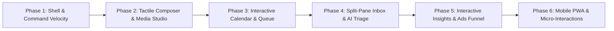

# MS Social Pilot — UI & UX Improvement Plan (v1.1 Roadmap)

This roadmap defines the next-generation UI and UX improvements for **MS Social Pilot** (`app/`), building on the clean `v1.0.0` foundation (5-hub navigation, 8 light/dark theme palettes, unified sticky filter bars, and responsive mobile drawer).

---

## Executive Vision

Deliver a fast, tactile, keyboard-first social media command center where creators, agencies, and marketing teams can move from **idea -> multi-channel draft -> visual calendar schedule -> inbox engagement -> cross-channel attribution** without friction, page reloads, or context switching.

---

## Phase 1: Shell, Navigation & Command Velocity

### 1.1 Enhanced Command Palette (`Cmd+K` / `Ctrl+K`)
- **Instant Deep Search**: Extend `src/components/AppShell.tsx` command palette beyond static routes to query recent drafts, scheduled posts, connected channels, saved inbox views, and active ad campaigns in real time.
- **Inline Quick Actions**: Execute high-frequency actions directly from the palette without leaving the current page:
  - *Switch Workspace* (`> workspace <name>`)
  - *Toggle Theme / Dark Mode* (`> theme dark`, `> palette vivid`)
  - *Create Draft for Channel* (`> post instagram`)
  - *Jump to Unread Inbox Mentions* (`> inbox unread`)
- **Recent History & Pinning**: Remember the user's last 5 visited screens/channels at the top of the palette when opened with an empty query.

### 1.2 Workspace & Channel Context Bar
- **Channel Health Indicators in Switcher**: Show live connection status dots (healthy, expiring soon, reconnect required) next to channel avatars in the sidebar and channel filter pills.
- **Collapsible Sidebar Rail Mode**: Allow power users on desktop (`1280px+`) to collapse the left navigation sidebar into a compact `64px` icon rail with instant hover tooltips, maximizing horizontal canvas space for the Calendar, Inbox split view, and Ads tables.

---

## Phase 2: Tactile Multi-Channel Composer & Media Studio

### 2.1 Live Side-by-Side Network Previews
- **Synchronized Device Frame Previews**: In `src/modules/publishing/ui/ComposerWorkspace.tsx`, upgrade the right-hand preview pane with realistic platform cards (Facebook Feed, Instagram Carousel/Reel, LinkedIn Article Post, X Thread, TikTok Vertical Frame) that reflect exact character fold cutoffs (`...more`), hashtag highlighting, and aspect-ratio crop overlays.
- **Per-Channel Diff Indicator**: Visually badge channel tabs that have customized text or media overrides compared to the master draft, with a one-click *"Reset to master copy"* action.

### 2.2 Drag-and-Drop Media & Aspect-Ratio Guardrails
- **Drag-to-Reorder Carousel Grid**: Allow dragging media thumbnails to reorder multi-photo carousels with live ordinal badges (`1`, `2`, `3`).
- **Inline Crop & Aspect-Ratio Warnings**: Immediately surface non-destructive aspect-ratio warnings (e.g., Instagram `4:5` vs `1.91:1` or Reel `9:16`) directly on the thumbnail card before dispatch.
- **First-Comment Timeline Preview**: Render the scheduled first comment (and its delay badge, e.g., `+15m after publish`) directly beneath the simulated post preview card so authors see the complete conversation starter.

---

## Phase 3: Interactive Calendar, Swimlanes & Queue

### 3.1 Drag-and-Drop Calendar Rescheduling
- **Slot-to-Slot Dragging**: In `src/modules/publishing/ui/CalendarWorkspace.tsx`, enable dragging scheduled post cards across days or time slots in Month, Week, and Swimlane views, triggering the shared reschedule service with optimistic UI feedback.
- **Best-Time Heatmap Overlay**: Toggle subtle emerald/accent background tinting on calendar time slots that match the workspace's computed high-engagement windows (`bestTimes`).

### 3.2 Quick-Peek Post Popover & Inline Approval
- **Click-to-Peek Drawer/Popover**: Clicking any calendar card opens a rich floating popover showing full media, destination statuses, approval stage, and team comments—allowing managers to **Approve**, **Duplicate**, or **Reschedule** without navigating away from the calendar grid.
- **Empty-Slot Quick Create**: Hovering over any future calendar cell reveals a `+ Schedule here` ghost button that opens the composer pre-filled with that exact date, time, and swimlane channel.

---

## Phase 4: Split-Pane Inbox & Keyboard Triage

### 4.1 Superhuman-Style Keyboard Navigation
- **Full Keyboard Triage**: In `src/modules/inbox/ui/InboxWorkspace.tsx`, support single-key shortcuts when the reply input is not focused:
  - `j` / `k`: Next / previous conversation or comment thread
  - `e`: Resolve / archive thread and auto-advance to next unread item
  - `r`: Focus reply composer
  - `a`: Open assignee picker
  - `s`: Insert saved reply snippet (`/` slash command inside the reply box)
- **Shortcut Cheat-Sheet Modal (`?`)**: Press `?` anywhere in Inbox to view keyboard shortcuts.

### 4.2 Rich Thread Context & AI Reply Assist
- **Original Post Context Card**: Pin a collapsible card at the top of comment threads showing the parent published post's thumbnail, caption snippet, and publish date so agents always know what post the commenter is reacting to.
- **One-Click Tone Replies**: Add quick AI assist chips above the reply box (*Friendly*, *Supportive*, *Concise FAQ*, *Translate to EN/FR*) powered by the workspace's configured Studio AI provider.

---

## Phase 5: Interactive Insights & Paid Ads Funnel

### 5.1 Cross-Filtered Insights Canvas
- **Click-to-Filter Charts**: Clicking a day or week bar on the Insights Overview ECharts timeline filters the *Top Posts* and *Channel Breakdown* tables below to that exact window.
- **Custom Executive PDF / Share Snapshot**: Add a clean print/snapshot layout for `/insights` and `/sharing` links with executive KPI summary cards, sparkline deltas, and agency white-label branding.

### 5.2 Visual Ads Hierarchy & Budget Pacing
- **Campaign -> Ad Set -> Ad Breadcrumb Drilldown**: In `src/modules/ads/ui/AdsManageWorkspace.tsx`, clicking a Campaign row filters the Ad Sets tab to that campaign and displays a dismissible breadcrumb pill (`Campaign: Spring Launch ×`), making hierarchical navigation effortless.
- **Spend & CTR Inline Sparkbars**: Render subtle inline progress bars inside the `Spend` and `CTR` table cells to let media buyers spot top-spending and top-performing ads at a glance.

---

## Phase 6: Mobile PWA Polish & Micro-Interactions

### 6.1 Mobile Bottom Action Sheets & Gestures
- **Responsive Bottom Sheets**: Convert desktop dropdown menus and confirmation modals into thumb-friendly bottom sheets on viewports `< 768px`.
- **Sticky Mobile Composer Bar**: Keep media upload, AI assist, and primary *Schedule / Publish* buttons anchored above the mobile virtual keyboard.

### 6.2 Optimistic Transitions & Skeleton States
- **Content-Matched Skeletons**: Replace generic loading spinners with layout-accurate shimmer skeletons matching KPI grids, calendar cells, and inbox thread rows.
- **Toast Undo Stack**: Provide a 5-second undo toast for non-destructive workspace actions (filter resets, view changes, draft archiving).

---

## Prioritized Implementation Matrix

| Batch | Focus Area | Primary Files | Complexity | Impact |
| :--- | :--- | :--- | :---: | :---: |
| **Batch A** | Collapsible Sidebar Rail + Enhanced `Cmd+K` Search | `src/components/AppShell.tsx`, `src/styles/app-shell.css` | Low | High |
| **Batch B** | Composer Side-by-Side Network Previews + Carousel Reorder | `src/modules/publishing/ui/ComposerWorkspace.tsx`, `PostPreview.tsx` | Medium | High |
| **Batch C** | Calendar Quick-Peek Popover + Slot Quick-Create + Best-Time Overlay | `src/modules/publishing/ui/CalendarWorkspace.tsx` | Medium | High |
| **Batch D** | Inbox Keyboard Triage (`j`/`k`/`e`/`r`) + `/` Saved Reply Slash Menu | `src/modules/inbox/ui/InboxWorkspace.tsx` | Medium | High |
| **Batch E** | Ads Campaign Drilldown Breadcrumbs + Inline Spend Sparkbars | `src/modules/ads/ui/AdsManageWorkspace.tsx` | Low | Medium |
| **Batch F** | Mobile Bottom Sheets + Shimmer Skeletons | `src/components/ui/*`, `src/styles/layer.css` | Low | Medium |
