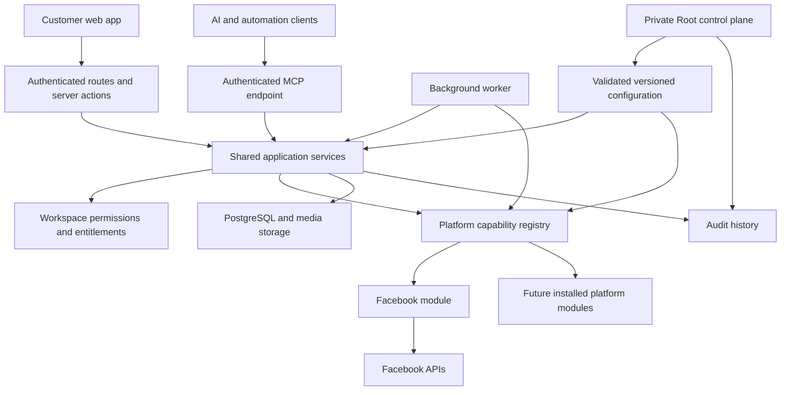

# MS Social Pilot architecture

## Authority

[ARCHITECTURE_CONTRACT.md](ARCHITECTURE_CONTRACT.md) is the mandatory target for Codex, Claude and subagents. This file describes implementation and gaps only. Follow [../../AGENTS.md](../../AGENTS.md); do not infer architecture permission from an unfinished boundary.

Updated 2026-10-15. This document distinguishes the intended production architecture from the current rebuild. A component existing in source is not proof that its complete workflow is production-ready.

## Structure

The rebuild uses Next.js App Router, React, TypeScript, Prisma, and PostgreSQL. A separate worker executes scheduled publishing and provider synchronization. UI, API, MCP, and worker entry points must converge on shared application services so that authorization and behavior do not diverge.

## Product modules

Product modules describe what a customer can do. They are independent of social networks.

| Module | Responsibility |
| --- | --- |
| Publishing | Compose, drafts, CSV import with first comments, media, approvals, queue, calendar, publishing, status refresh, and local/remote deletion |
| Inbox | Conversations and comments, replies, moderation, resolution, and synchronization |
| Analytics | Selected-channel audience totals, metric series and breakdowns, provenance, coverage, freshness, and export |
| Ads | Selected ad accounts, delivery results, object status, budgets, and supported creation/management workflows |
| Settings | Workspace connections and account selection, team permissions, account security, appearance, MCP access, and data controls |
| Root | Private installation configuration, platform availability, users, workspaces, and operational controls |

`src/modules/` contains customer module manifests. The shell derives navigation from these manifests and workspace entitlements. Root routes have separate instance-owner authorization. The current route families are `/publishing/*`, `/inbox`, `/analytics`, `/ads/*`, `/settings/*`, and `/root/*`.

## Platform modules

Platform modules describe how a provider fulfills a capability. Facebook is the only installed platform module. Existing Instagram source is scaffolding/legacy compatibility; it is not an enabled customer platform.

Each platform owns its manifest, settings definitions, OAuth flow, discovery, credentials/scopes, API transport and pagination, provider validation, publishing, status mapping, remote deletion, inbox behavior, analytics interpretation, Ads behavior, and background hooks. Provider UI choices and explanatory copy also belong to the module. Shared screens consume safe serializable metadata; credentials and server functions never cross to the browser.

The module registry checks installation, Root enablement, and capability support before dispatch. Unsupported operations must be omitted from the customer experience. A general `ads` or `publishing` flag alone is insufficient proof that every sub-operation exists; finer operation coverage remains necessary.

Adding a platform requires implementing and testing its module, then registering it in the installed lists and shipping a release. Root manages settings and availability of installed modules. Root cannot create a new provider implementation merely by entering an API URL.

Current locations:

- `src/platforms/<provider>/`: provider engine, settings manifest, jobs, Inbox and Ads implementation, and metric metadata.
- `src/server/platforms/`: configuration-to-engine wiring, connection orchestration, installed host registration, and capability dispatch.
- `src/platforms/types.ts`: common operation contracts; remaining provider-specific types must be removed from this shared contract.

Shared analytics now consumes normalized module outputs: provider storage queries, metric interpretation and currency partitions live in the Facebook module. The strict final boundary is still incomplete: some shared contract types and route error mappings name Facebook, provider host wiring remains outside its final module directory, and operation declarations are too coarse to prove every sub-capability. Moving files alone does not close these gaps.

## Connection and data lifecycle

1. An authorized member starts a connection for an available platform.
2. Server-bound OAuth state ties the callback to the user and workspace.
3. The platform discovers channels and ad accounts. Tokens remain encrypted server-side.
4. A selection modal shows discovered resources with checkboxes. Only selected resources become active product resources; users can revise the selection later.
5. Shared workflows resolve each resource's provider and invoke its enabled capability host.
6. Disconnect asks whether related app data should be retained or deleted. Local post deletion separately offers remote deletion when a remote publication exists.

Workspace is the tenant boundary. Connections own discovered channels and ad accounts; posts have per-channel delivery records and remote IDs; conversations/comments, insight records, media, and job records link back to workspace-owned resources. Existing production tables are currently accessed through a partial Prisma compatibility view. This is not yet a clean final persistence model or an approved production migration schema.

## Authorization and MCP

Every operation must enforce authenticated identity, workspace membership, feature entitlement, feature read/write permissions, resource/channel scope, platform availability, and operation-specific provider grants. Client-side hiding is only presentation; mutation services repeat server-side checks.

MCP is served at `/api/mcp`. It supports authenticated workspace access, scoped API keys, tools/resources, confirmations for writes, and audit records. It calls the same application services as the web app wherever those services exist. Root MCP access is restricted separately; workspace API keys cannot gain installation-owner privileges. Full UI/API/MCP parity is still incomplete and must be verified capability by capability.

## Configuration

The typed configuration registry supplies schemas, defaults, groups, safe display metadata, and a schema version. Runtime reads validate persisted values. Root writes validate changes and save audit history transactionally. Secrets are encrypted and omitted from ordinary configuration reads.

The required final coverage includes platform settings, endpoints/scopes, limits, schedules, permissions, entitlements, branding/themes, retention, logging, jobs, and MCP. Some registered options are still marked planned, and not all current literals are registry-backed. Therefore the requirement that Root manages every operational option is not complete.

Bootstrap trust remains outside ordinary Root editing: database access and encryption-key material must be available before Root can read configuration. Provider protocol constants belong inside adapters, documented separately from configurable policy.

## Design and UX

One shell, semantic design tokens, shared components, and selectable Grove, Coast, Clay, and Nightfall themes serve every module. `DESIGN.md` records the visual system; `UX-CONTRACT.md` records behavior. Navigation, filters, and resource selection share the sidebar. Responsive layouts, keyboard focus, validation, loading/error/empty states, confirmations, and permission-sensitive actions must behave consistently across screens. The design foundation exists; complete browser verification and polish are still release gates.

## Jobs and release safety

The worker dispatches shared publishing and module-owned synchronization with job leases, run history, retries, and configured schedules. Production cutover must prevent the legacy and rebuild workers from publishing the same queue.

The legacy app remains the production service. The existing `socialpilot-deploy` command still targets legacy. A rebuild cutover needs an exact release, needed-data migration, media verification, functional and authorization checks, real provider and MCP tests, a restorable backup, and a rehearsed proxy/service rollback. `docs/CUTOVER.md` records the current blockers. No production-ready or deployment claim follows from a passing build alone.

## Verified progress and remaining scope

Shared Ads dispatches by selected-account provider, uses module-owned creation metadata, and enforces current resource scope in services and lists. Shared analytics loading and aggregation consume neutral metric/audience inputs; the enabled Facebook host owns storage reads and semantics. Monetary series are separated by currency, ratios derive from source totals, unknown numeric measures use snapshots, and duplicate retained fields are not double-counted. The integrated worktree passed 388 tests (including real local legacy-schema post-delivery and Inbox audit probes), TypeScript checking, and the production build. Shared selected-resource visibility now feeds channel reads, Home, Ads account lists and MCP destinations; enabling a selection checks module availability and credential health. Connection status copy is managed by Root. Shared native dialogs now recover focus after failures and retain failed Inbox deletion context; targeted Chrome checks cover Ads/Inbox recovery and keyboard behavior. A dedicated synthetic browser preview now exists; [PREVIEW_QA.md](PREVIEW_QA.md) records checked sample workflows and remaining findings. Full browser and live-provider verification are separate release gates.

Remaining work includes complete platform-directory consolidation and shared-contract cleanup, granular capability declarations, full metric/provider-operation coverage beyond the current stored account-level Analytics inputs, complete Facebook media and Ads lifecycles, legacy capability parity, comprehensive Root configuration coverage, complete MCP parity, design/browser checks, production-shaped data/permission checks, live provider verification and cleanup, migration/rollback rehearsal, and rebuild deployment.
