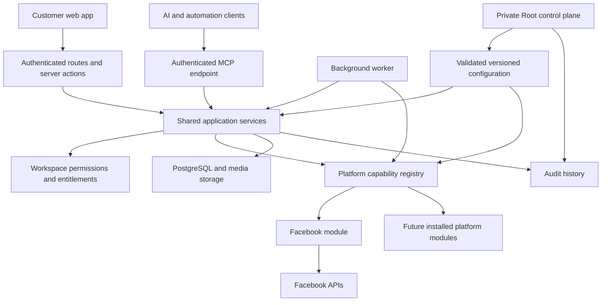

# MS Social Pilot architecture

## Authority

[ARCHITECTURE_CONTRACT.md](ARCHITECTURE_CONTRACT.md) is the mandatory target for Codex, Claude and subagents. This file describes implementation and gaps only. Follow [../../AGENTS.md](../../AGENTS.md); do not infer architecture permission from an unfinished boundary.

Updated 2026-10-17. This document distinguishes the intended production architecture from the current rebuild. A component existing in source is not proof that its complete workflow is production-ready.

## Structure

The rebuild uses Next.js App Router, React, TypeScript, Prisma, and PostgreSQL. A separate worker executes scheduled publishing and provider synchronization. UI, API, MCP, and worker entry points must converge on shared application services so that authorization and behavior do not diverge.

## Product modules

Product modules describe what a customer can do. They are independent of social networks.

| Module | Responsibility |
| --- | --- |
| Publishing | Compose, drafts, duplication, CSV import with first comments, media, approvals, queue, calendar, publishing, status refresh, and local/remote deletion |
| Inbox | Conversations and comments, replies, moderation, resolution, and synchronization |
| Analytics | Selected-channel audience totals, metric series and breakdowns, provenance, coverage, freshness, and export |
| Ads | Selected ad accounts, delivery results, object status, budgets, and supported creation/management workflows |
| Settings | Workspace connections and account selection, team permissions, account security, appearance, MCP access, and data controls |
| Root | Private installation configuration, platform availability, users, workspaces, and operational controls |

`src/modules/` contains customer module manifests. The shell derives navigation from these manifests and workspace entitlements. Root routes have separate instance-owner authorization. The current route families are `/publishing/*`, `/inbox`, `/analytics`, `/ads/*`, `/settings/*`, and `/root/*`.

The user clarified on 2026-10-16 that Root administers every product and platform module while module source remains self-contained outside Root. Current implementation is incomplete against that requirement: product manifests live under `modules/`, but much product implementation remains distributed across `app/` and `server/`; Root now has a unified module navigation/settings workflow, while module-specific operational health/actions and complete source encapsulation remain unfinished. Do not describe the current layout as complete module encapsulation or complete Root coverage.

## Platform modules

Platform modules describe how a provider fulfills a capability. Facebook is the only installed platform module. Existing Instagram source is scaffolding/legacy compatibility; it is not an enabled customer platform.

Each platform owns its manifest, settings definitions, OAuth flow, discovery, credentials/scopes, API transport and pagination, provider validation, publishing, status mapping, remote deletion, inbox behavior, analytics interpretation, Ads behavior, and background hooks. Provider UI choices and explanatory copy also belong to the module. Shared screens consume safe serializable metadata; credentials and server functions never cross to the browser.

The module registry checks installation, Root enablement, and capability support before dispatch. Unsupported operations must be omitted from the customer experience. A general `ads` or `publishing` flag alone is insufficient proof that every sub-operation exists; finer operation coverage remains necessary.

Adding a platform requires implementing and testing its module, then registering it in the installed lists and shipping a release. Root manages settings and availability of installed modules. Root cannot create a new provider implementation merely by entering an API URL.

Current locations:

- `src/platforms/<provider>/`: provider engine, settings manifest, runtime construction, OAuth state and connection/discovery flow, host assembly, jobs, Inbox and Ads implementation, metric metadata and protocol error classification.
- `src/server/platforms/`: neutral host contracts (`host.ts`), explicit installed host registration (`index.ts`), resource visibility and capability dispatch (`registry.ts`).
- `src/platforms/types.ts`: common operation contracts. Campaign objectives are opaque strings validated by each module; the Facebook enum belongs to its protocol file.

Shared analytics now consumes normalized module outputs: provider storage queries, metric interpretation and currency partitions live in the Facebook module. Inbox reply eligibility and its presentation metadata also come from the selected module; the Messenger window and its configuration read live inside Facebook. UI and MCP Inbox reads share selected-channel, workspace, permission and enabled-module filters. Media HTTP and MCP tools now share typed safe validation/storage failures; unexpected storage errors are masked. Ads service and module failures use safe typed operation errors; shared Ads HTTP routes no longer match provider messages, and MCP Ads operation calls apply the same sanitization boundary. The strict final boundary is still incomplete: other shared route error mappings name Facebook, legacy-shaped MCP reads need consolidation, and operation declarations are too coarse to prove every sub-capability. Moving files alone does not close these gaps.

## Root navigation and module settings ownership

Root sidebar groups **Shared controls**, **Product modules** and **Platform modules**. Groups are native keyboard-accessible disclosures; the current section expands automatically. Product/platform links come from installed manifests, rather than a second hardcoded catalog. `/root/modules` lists installed product modules; `/root/modules/[id]` and `/root/platforms/[id]` expose only that module's controls. Unknown/uninstalled identifiers are refused after Root authorization. The existing two-sidebar shell and mobile drawer remain the only navigation surfaces.

`lib/config/ownership.ts` assigns one owner to safe registry metadata. Platform entries declare their owner inside their adapter and take precedence over product namespaces, so the provider-owned reply window remains under its provider despite its historical key. Product manifests declare namespaces and additional legacy setting keys; module/feature availability is assigned to the declaring product automatically. Global authentication, shared worker/storage/locking policies and other shared infrastructure remain in Shared configuration. Existing key names, runtime readers, values and encrypted credentials are unchanged.

Registry version 34 exposes `owner` metadata through safe definitions (including HTTP/MCP), without saved secret values. Root module screens reuse the existing validated/audited setting service and scoped form. Product availability/feature controls appear first; provider categories omit the repeated provider group prefix. Search/categories live in the contextual sidebar and cannot return unrelated module controls. Module form state remounts by owner when switching modules. Store failures keep navigation/recovery available; declared adapter operations are explicitly distinct from live-provider health or complete coverage.

This implements module menu/settings organization, not the full module-management end state: per-module health/actions, missing operator workflows, every technical configuration consumer and full product implementation encapsulation still require work.

## Connection and data lifecycle

1. An authorized member starts a connection for an available platform.
2. Server-bound OAuth state ties the callback to the user and workspace.
3. The platform discovers channels and ad accounts. Tokens remain encrypted server-side.
4. A selection modal shows discovered resources with checkboxes. Only selected resources become active product resources; users can revise the selection later.
5. Shared workflows resolve each resource's provider and invoke its enabled capability host.
6. Disconnect asks whether related app data should be retained or deleted. Local post deletion separately offers remote deletion when a remote publication exists.

Workspace is the tenant boundary. Connections own discovered channels and ad accounts; posts have per-channel delivery records and remote IDs; conversations/comments, insight records, media, and job records link back to workspace-owned resources. Existing production tables are currently accessed through a partial Prisma compatibility view. This is not yet a clean final persistence model or an approved production migration schema.

## Authorization and MCP

Every customer workspace operation must enforce authenticated identity, workspace membership, feature entitlement, feature read/write permissions, resource/channel scope, platform availability, and operation-specific provider grants. Private Root operations instead require current installation-owner authority and do not inherit workspace privileges. Client-side hiding is only presentation; mutation services repeat server-side checks.

MCP is served at `/api/mcp`. It supports authenticated workspace access, scoped API keys, tools/resources, confirmations for writes, and audit records. It calls the same application services as the web app wherever those services exist. Root MCP access is restricted separately; workspace API keys cannot gain installation-owner privileges. Full UI/API/MCP parity is still incomplete and must be verified capability by capability. All tool calls now expose only deliberate `OperationError` messages/codes; unexpected failures are masked at the shared MCP response boundary. Resource failures carry the same safe code in JSON-RPC `error.data`. Publishing, Inbox, connection selection and data-control validation/access failures use typed public errors, while raw database/provider/storage exceptions remain untrusted. Unknown write failures tell clients to check current state before repeating. Secondary MCP audit failures preserve returned service outcomes with `mcpAuditRecorded: false` and an explicit warning rather than falsely reporting action failure. Domain audits, remote-success/local-persistence uncertainty and durable reconciliation still require operation-specific guarantees; this boundary is not proof of exactly-once delivery or complete audit durability.

Private Root workspace access uses `server/root/workspace-access.ts` for UI API and MCP. It rechecks current installation-owner authority and disabled-account state, takes an exclusive workspace row lock, refuses active data purges, requires an exact stable-ID action confirmation and commits the state change with its audit entry. The legacy `suspendedAt` column is accessed through bounded compatibility SQL; no schema migration was applied. Shared workspace operations take a compatible shared row lock and refuse a suspended workspace before side effects. Provider background sync now uses that same lock across network retries and storage. In-flight work finishes before suspension commits. Ordinary customer entitlements are denied; private Root inspection and restoration remain possible.

The new Root MCP tools are `list_root_workspaces` and `set_root_workspace_access`, with `msp://root/workspaces`. Reads use the smaller configured Root directory and MCP result limits. These tools have typed public errors and redact unexpected failures; workspace API keys cannot list or invoke them. Root operations deliberately bypass the ordinary shared workspace operation wrapper to avoid upgrading a held shared lock to exclusive and to permit restoration. The HTTP MCP authentication path now supports a distinct installation identity without workspace membership; see the context rules below.

Private Root audit history now uses `server/root/activity.ts`. UI `/root/activity`, HTTP `/api/root/activity`, MCP `list_root_activity` and resource `msp://root/activity` share a service that rechecks current installation-owner/disabled state before any audit query. Action/person substring search is literal and SQL-bound; exact workspace filtering matches top-level `detail.workspaceId` only. UTC date endpoints are inclusive; the SQL upper bound is the following midnight. Validated date text is cast to PostgreSQL date; cursor anchors bind canonical ISO text with explicit timestamp casts so comparisons to legacy UTC `TIMESTAMP(3)` storage do not depend on the session timezone. Tuple cursors order by that millisecond timestamp and stable ID, bind to normalized filters and support nearest-newer/older navigation without offset drift from new events. The response contains the existing allowlisted metadata projection, never raw audit payloads. Cursor tokens are seek positions, not authorization grants.

Operational audit page, search and encoded cursor bounds are validated Root settings. The only fixed cursor invariants are its version, canonical base64url JSON shape, SHA-256 filter digest and timestamp precision matching `TIMESTAMP(3)`. This adds no DDL. Substring/workspace queries still need production-volume plan/load evidence and possible reviewed indexes; exports, raw-detail inspection, retention and generic log/error administration are not implemented by this read surface. Private MCP context authentication is now independent of membership as described below.

MCP identities are discriminated as workspace or installation in `server/mcp/types.ts`. `?scope=installation` accepts only a fully verified active installation-owner session, does not load workspace grants, and exposes only private Root tools/resources. `?scope=workspace` requires actual membership, current grants and a permitted workspace role, and does not expose Root privileges even to an installation owner. Without an explicit scope, current workspace behavior remains; an owner falls back to private installation context when membership/role/grants are absent. A supplied bearer always controls authentication and never falls back to a browser cookie; workspace keys cannot enter installation context. All workspace contexts disable the installation-owner suspension-inspection exception in `loadEntitlements`; workspace access does not inherit private authority from its session or key creator. Invalid/repeated scope values are rejected. Global MCP availability and configured limits still apply, with a per-owner installation rate key and no fabricated workspace ID/entitlements.

`server/mcp/root-tools.ts` owns private definitions, resources and the shared dispatcher for both session contexts. Every Root operation rechecks current account/owner state before services; all its unexpected failures are masked. Configuration input is checked against the same typed registry and exact confirmation, then `saveConfig` commits its setting and value-free audit atomically. The former independent post-save MCP audit was removed for this operation so a secondary audit failure cannot misreport a committed change as failed. Workspace access retains its own transactional audit. HTTP authentication/transport responses and protocol replies use `no-store`. Root overview contains private session-connection guidance; a membership-free owner encountering `/no-workspace` recovers to `/root`. Customer empty states retain invitation/sign-out recovery without private setup copy.

Installation-scoped bearer issuance/OAuth is not implemented; the private context currently requires a verified browser session. This closes the membership dependency for existing Root operations, not all Root UI/API/MCP capability parity. The shared MCP unexpected-error boundary is implemented; durable domain auditing/reconciliation and the complete operator inventory remain open.

## Root user directory and account controls

Private Users UI, HTTP `GET /api/root/users`, MCP `list_root_users` and resource `msp://root/users` share `server/root/users.ts`. Current active Root authority is required before reading names/emails, access state, membership/factor counts or active verified session counts. Search is literal (PostgreSQL wildcard characters escaped), bounded by the registry and combined with all/active/disabled/owners status. Pagination is bounded and stale pages clamp to the matching count; credentials, factor material and session identifiers are excluded.

HTTP account actions and MCP `manage_root_user` share `root/user-controls.ts`. Serializable transactions lock actor/target user rows in stable order, recheck current active installation authority and target state, require shared exact confirmations, preserve self/last-owner/owner-factor-reset guards and commit local changes/session revocation/domain audit together. Serialization conflicts request a reload; unexpected failures are masked. Workspace API keys cannot reach these operations. Sign out changes browser sessions, not workspace API keys; disabling the creator separately blocks key authentication through current-user checks.

User filters and pagination live in the contextual sidebar. Dialogs retain confirmation/error input, prevent duplicate submits, and require a matching HTTP receipt before showing success and refreshing. Unknown results ask operators to inspect state/activity first. Registry version 33 manages user-search and account transaction bounds. User deletion, privilege assignment, plans and complete per-module operations/health remain incomplete.

## Configuration

The typed configuration registry supplies schemas, defaults, groups, safe display metadata, and a schema version. Runtime reads validate persisted values. Root writes validate changes and save audit history transactionally. Secrets are encrypted and omitted from ordinary configuration reads.

The required final coverage includes platform settings, endpoints/scopes, limits, schedules, permissions, entitlements, branding/themes, retention, logging, jobs, and MCP. Some registered options are still marked planned, and not all current literals are registry-backed. Therefore the requirement that Root manages every operational option is not complete.

Bootstrap trust remains outside ordinary Root editing: database access and encryption-key material must be available before Root can read configuration. Provider protocol constants belong inside adapters, documented separately from configurable policy.

## Design and UX

One shell, semantic design tokens, shared components, and selectable Grove, Coast, Clay, and Nightfall themes serve every module. `DESIGN.md` records the visual system; `UX-CONTRACT.md` records behavior. Navigation, filters, and resource selection share the sidebar. Responsive layouts, keyboard focus, validation, loading/error/empty states, confirmations, and permission-sensitive actions must behave consistently across screens. The design foundation exists; complete browser verification and polish are still release gates.

The user approved core design first on 2026-10-16. The shell now has a narrow module rail and contextual sidebar, permission-aware New post action, membership-backed workspace switching, and one contextual drawer on narrower screens. `SidebarDock` places route-local Root configuration search/categories into that same sidebar. Posts defaults to Table and offers Feed/Cards using one scoped paginated query and existing action controls; the neutral preview includes stored text, media/link references, first comments and destination outcomes. A separate private Root manifest generates Overview, Operations, Activity and installation navigation. Overview uses actual counts; activity reads bounded, redacted audit history with sidebar search, UTC date/workspace filters and tuple cursor pagination; worker health distinguishes unavailable telemetry from missing replacement-worker heartbeats. The next publishing batch adds a recoverable dedicated composer, shared full previews in queue/approvals and calendar dialogs, server-resolved workspace time presentation and guarded synthetic image examples. Transport failures retain composer state and distinguish an unconfirmed save from a confirmed failure. This is continuing core design work, not complete core or Root parity. Follow [CORE_DESIGN_PLAN.md](CORE_DESIGN_PLAN.md) before adding further Facebook operations.

## Jobs and release safety

The worker dispatches shared publishing and module-owned synchronization with job leases, run history, retries, and configured schedules. Production cutover must prevent the legacy and rebuild workers from publishing the same queue.

The legacy app remains the production service. The existing `socialpilot-deploy` command still targets legacy. A rebuild cutover needs an exact release, needed-data migration, media verification, functional and authorization checks, real provider and MCP tests, a restorable backup, and a rehearsed proxy/service rollback. `docs/CUTOVER.md` records the current blockers. No production-ready or deployment claim follows from a passing build alone.

## Verified progress and remaining scope

Shared Ads dispatches by selected-account provider, uses module-owned creation metadata, and enforces current resource scope in services and lists. Shared analytics loading and aggregation consume neutral metric/audience inputs; the enabled Facebook host owns storage reads and semantics. Monetary series are separated by currency, ratios derive from source totals, unknown numeric measures use snapshots, and duplicate retained fields are not double-counted. The current integrated suite passed 503 tests, including both rollback-only PostgreSQL delivery and Inbox audit probes against the dedicated synthetic preview database. Current TypeScript checking and an isolated production build passed. Ads HTTP routes and all MCP Ads tools now share safe typed failure handling, including creation metadata; resource-read failures return safe JSON-RPC errors. Ads mutations accept exactly one status or budget change, and MCP no longer coerces string budgets. Shared selected-resource visibility now feeds channel reads, Home, Ads account lists and MCP destinations; enabling a selection checks module availability and credential health. Inbox policy is dispatched through platform hosts and UI/MCP Inbox selection filters are shared. Connection status copy is managed by Root. Shared native dialogs now recover focus after failures and retain failed Inbox deletion context; targeted Chrome checks cover Ads/Inbox recovery and keyboard behavior. A dedicated synthetic browser preview now exists; [PREVIEW_QA.md](PREVIEW_QA.md) records checked sample workflows and remaining findings. Full browser and live-provider verification are separate release gates.

Remaining work includes shared route/MCP cleanup, granular capability declarations, full metric/provider-operation coverage beyond the current stored account-level Analytics inputs, complete Facebook media and Ads lifecycles, legacy capability parity, comprehensive Root configuration coverage, complete MCP parity, design/browser checks, production-shaped data/permission checks, live provider verification and cleanup, migration/rollback rehearsal, and rebuild deployment.

## Root diagnostics and module operations — 2026-10-16

`server/root/diagnostics.ts` is the private shared UI/HTTP/MCP service. `/root/operations` contains Shared infrastructure checks; each installed product/platform settings screen contains its own diagnostic history, safe results and sidebar run controls. Scope IDs derive from installed manifests. Provider connection choices are bounded to the chosen platform, and exact IDs can be tested through HTTP/MCP. Root may test installed platforms before enabling customer access. No arbitrary URL, script, tool name or provider write is accepted.

The service rechecks active installation authority, requires `RUN DIAGNOSTICS <scope>`, acquires a PostgreSQL advisory transaction lock per scope and records a start before preparing checks. Cooldown spans owners, interfaces and connection choices. Unconfirmed starts block retries until recovery; each start retains a recovery floor at least its original total deadline plus two database timeouts, so later shorter settings cannot permit early overlap. A total preparation/check deadline cancels provider requests, marks the active check failed and skips remaining checks. Database probes/audit transactions have separate statement/transaction bounds; not all background read promises are cancellable at the database driver. Returned outcomes are preserved with a warning if completion auditing fails. History retains started-but-unconfirmed runs explicitly; it does not label them successful.

`server/diagnostics/checks.ts` owns neutral configuration validation, database reads, in-memory authenticated encryption, media-directory permission checks and replacement worker activity. Product checks validate only their owned configuration and job evidence. `platforms/facebook/diagnostics.ts` owns OAuth setting presence, selected-source expiry/revocation, authenticated identity comparison, current requested grants and read-only Page/ad-account discovery. These checks reuse the configured adapter transport, combined per-request/suite cancellation and pagination limits; they neither persist discovery nor change provider data. Success counts only the returned bounded discovery set. A pass is not proof of callback registration, every selected resource, publishing, media, inbox delivery or spend-changing access. Preview credentials/endpoints are synthetic and deliberately fail remote reads.

Product manifests now declare background job names, labels and schedule keys, shared by the worker and Root health. The Root-managed `jobs.order` preserves the previous dispatch priority by default; unlisted installed jobs follow in manifest order. `root/operations.ts` reads replacement-only run history and heartbeats in the persisted `rebuild-` identity namespace, projects enum outcomes/timestamps/durations/error-presence and omits stored raw errors, summaries and hostnames. It never interprets shared jobs as provider-specific telemetry. UI/API/MCP use this same current-Root-checked service. No-job modules say checks are skipped rather than inventing worker evidence. The old mixed legacy/rebuild latest-job read has been removed.

Registry version 35 supplies diagnostics availability, cooldown, incomplete-run recovery, total check deadline, database timeout, bounded history, operational timezone and recent-run/stale-heartbeat controls. Explicit timezone formatting avoids server/browser hydration disagreement; ISO HTTP/MCP timestamps remain UTC. Other Root date screens have not all adopted this preference. At that batch, private MCP had ten tools/six resources, including operations and diagnostics; the deletion-recovery addition below expands that inventory. Workspace bearer keys remain excluded.

This batch adds no application migration. The existing worker migration was missing from the isolated preview; it was applied there only after a local custom-format backup was restored and aggregate fixture counts matched. No worker was started and no production service or schema changed. Full platform-operation diagnostics, remote live-provider evidence, broader legacy operator controls, product encapsulation and production cutover gates remain unfinished.

## Inbox stored activity browsing — 2026-10-16

Inbox list/thread reads now live in `modules/inbox/server`, shared by the page, new no-store HTTP read routes and MCP `list_inbox`/`get_inbox_thread`. The former duplicate overview and MCP ORM lists were removed. Services recheck current active account, membership, entitlement, feature permission, workspace state and selected Inbox-capable channel visibility; key limits intersect current member grants. The Inbox shell now explicitly accepts this scoped reader path. Stable filter-bound tuple cursors support both directions, literal message/person search and separate history continuation without old 50-per-type/300-history truncation. Latest inbound reply eligibility is independent of the shown window. Counts and coverage copy say stored activity.

Registry version 36 adds Inbox-owned page/search/cursor bounds consumed by services and sidebar controls. The UI preserves list position, history position and selected conversation where valid, with distinct reset/empty/error states. A guarded synthetic 54-message fixture supports local browsing checks. No migration or remote provider operation is part of this batch. See PREVIEW_QA for evidence and remaining UX/provider/MCP gaps.

## Shared form behavior — 2026-10-16

The design layer now owns reusable field validation/focus (`components/FormValidation.tsx` over `lib/ui/form-validation.ts`) and multiline behavior (`components/AutoTextarea.tsx`). These helpers contain no provider branching or server authorization policy. Mutation forms use native metadata plus explicit domain checks; server/API services remain authoritative. Existing GET/action entry points declare server-owned validation rather than browser message bubbles. Form control changes do not add configuration, persistence schema or provider operations. Account password checks retain the provided UTF-8 byte policy; one-time MCP token display defaults to masked with explicit reveal/copy. Current verification and open cross-screen/browser limitations are in PREVIEW_QA.

## Inbox local workflow and write boundaries — 2026-10-16

`modules/inbox/server/access.ts` now owns shared current-identity/feature/channel authorization for reads and local workflow. `workflow.ts` owns validated resolve/reopen with a scoped update and matching legacy-named domain audit in one database transaction. This product-local operation no longer belongs to the Facebook host or requires live provider credentials. UI exposes local workflow independently of remote reply/moderation readiness; HTTP and MCP share the service, and MCP intersects its caller channel constraint. Only the service acquires the workspace operation lock, and it refreshes grants after the lock wait before opening the local mutation transaction. HTTP/MCP transport wrappers explicitly skip their generic lock for this operation, avoiding a nested-lock queue deadlock against purge/suspension.

Inbox action HTTP now masks unexpected errors through the shared typed boundary and returns no-store for all outcomes. Non-sync service receipts must explicitly confirm success. The client refuses malformed/missing/false receipts, validates displayed sync counts/timestamps and retains text/dialog context with honest unconfirmed-outcome copy. These are safety boundaries, not a durable remote operation journal. That batch introduced no schema change. The subsequent durable deletion batch below adds the journal, recovery, tombstones/lifecycle integration and MCP deletion; INBOX_WRITE_RECOVERY.md tracks remaining automatic/provider verification gaps.

Registry 37 adds Inbox-owned local transaction duration/acquisition bounds consumed by resolve/reopen; existing Shared controls still govern its workspace lock. No provider protocol timing is introduced into shared product logic.

## Durable Inbox deletion and private recovery — 2026-10-16

`modules/inbox/server/deletion.ts` now owns committed deletion intent, unique remote-resource claims, scoped status and atomic local finalization/audit. The Facebook host exposes credential-checked `prepareDeleteComment` returning a cancellable provider-only dispatch; local deletion/audit orchestration no longer belongs to Facebook. Non-rejected journal entries act as tombstones. Durable alias IDs preserve status after cleanup; recursive scoped descendant IDs and parent-first ingestion suppress stale descendants across sync windows. A shared fail-fast channel lock orders comment deletion/replies/moderation, manual/worker persistence and disconnection. The shared workspace guard remains single-owned by deletion services; HTTP/MCP skip their generic wrapper for these operations. Current grants are refreshed after acquiring locks.

UI/HTTP/MCP share status, initial deletion and provider-free local recovery. Private Root Inbox recovery exposes bounded safe history and explicitly manual operator attestation through UI/HTTP/MCP, distinct from automatic provider verification. Workspace keys cannot reach private Root operations. Registry 38 owns comment operation budgets, private history bounds and preserve-until-erasure policy; incompatible lock budgets fail before dispatch. Disconnection and workspace erasure refuse unresolved journal states; workspace exports intentionally include FK-owned recovery records. The reviewed additive table preserves resource identity without credentials/content and has no target/user FK.

See INBOX_WRITE_RECOVERY.md and PREVIEW_QA.md for current evidence and limits. Complete provider reply discovery, automatic remote verification/rejection classification, delayed effects after cancellation, complete Inbox parity, live Facebook deletion tests and full migration/cutover verification remain open. Production remains legacy.

## Shared Analytics explorer and comparison reads — 2026-10-16

`modules/analytics/server/read.ts` now provides the current-authorized snapshot used by the scoped page, no-store HTTP, CSV and workspace MCP tools/resource. Provider normalization stays inside Facebook; shared catalog inputs carry exact covered resource IDs and provider aggregation notes/labels. Strict UTC calendar ranges, resource selection, search and full detail continuation replace route/MCP forks. Root registry 39 owns read and presentation limits. The sidebar contains all report controls; cards retain bounded, explicitly labelled chart previews and full detail tables remain reachable. Reach overlap and latest-day rate coverage are explicit.

The duplicate raw `get_page_analytics` MCP path was removed following an exact-ID/scope overwrite finding; remaining Analytics tools use the shared service. [ANALYTICS_READS.md](ANALYTICS_READS.md) describes semantics, interface/config ownership and current performance/provider/UX limitations. [PREVIEW_QA.md](PREVIEW_QA.md) records synthetic local evidence. Complete analytics/legacy parity, live provider verification and production cutover remain open.

## Publishing operation authority and recovery UX — 2026-10-16

`modules/publishing/server/access.ts` and `guard.ts` own current service authorization, caller/channel intersection, the single workspace operation boundary, post/destination exclusion and whole-operation cancellation. All lifecycle and unconnected-draft mutations use this boundary; thin UI/MCP/worker callers skip their duplicate workspace wrappers. Local writes and domain audits share bounded transactions. Worker publication requires the same scheduled state/timestamp observed by its candidate scan. Connection removal shares destination locks, and cleanup refuses unresolved publishing/Inbox/post-deletion evidence. Registry 40 exposes the consumed Publishing operation budgets; registry 42 adds consumed post-deletion history and alias bounds.

Shared Publishing now asks adapter credential-readiness metadata for status sync; Facebook owns the configured scope rule and combines the neutral signal with its per-request timeout. Inline edit/delete use stateful actions retaining values/choices and focused feedback after failures. Actual Chrome success testing found and fixed swallowed Next redirects. [PUBLISHING_OPERATIONS.md](PUBLISHING_OPERATIONS.md) records the earlier guard work and evidence. The later post-deletion journal closes the missing durable remote-delete receipt path, but does not prove provider behavior, full publication recovery, selected-resource reads, provider formats/grants/live verification or complete parity. Production remains legacy.

## Separate first-comment receipts — 2026-10-16

The subsequent first-comment batch separates adapter post creation from comment dispatch. Shared Publishing commits its remote post receipt before the Publishing-owned comment service claims an attempt. Existing legacy comment ID/timestamp/error columns provide durable attempt evidence; ambiguous results cannot be automatically resent, while recognized adapter rejections permit an explicit retry. UI and MCP expose normalized per-destination states, explicit sending and audited external human attestation. Root registry 41 adds the consumed Facebook first-comment scope policy and OAuth/readiness integration. [FIRST_COMMENT_DELIVERY.md](FIRST_COMMENT_DELIVERY.md) defines state, ownership, local proof and remaining gaps. This closes the combined post/comment receipt-loss defect when the post receipt successfully commits; it does not recover a post receipt lost before commit or complete durable remote deletion. No DDL or production change was made.

## Durable Publishing post deletion and recovery — 2026-10-16

`modules/publishing/server/deletion.ts` now commits content-free remote identity intent before dispatch, records confirmed or uncertain outcomes, and atomically finalizes local removal and audits only after required remote confirmation. Provider exceptions remain uncertain; there is no automatic provider verification or retry. Per-destination receipts preserve partial success. Status, delete, finish, and externally verified outcome recording share the Publishing service across UI and workspace MCP. Private Root UI/HTTP/MCP provides bounded history and explicit human attestation. Local post/destination aliases support status after cleanup and cleanup of duplicate references; non-rejected identities remain tombstoned until workspace erasure. Normal mutations and worker status sync cannot resuscitate those remote identities, and cleanup refuses unresolved evidence. Registry 42 provides consumed bounds for Root history and per-operation aliases.

The fourth additive migration is pinned in the cutover verifier and was applied only to the isolated preview after a restore-verified backup; production was not changed. The backup at `/private/tmp/socialpilot-preview-before-post-deletion-20261016T210904Z.dump` was 244200 bytes, the exact source-table counts matched, and the migration restore matched 97 tables. This does not prove the full four-file rehearsal on a production-shaped baseline. The earlier publication receipt gap remains: accepted post creation with failed local receipt persistence has no equivalent journal. See [POST_DELETION_RECOVERY.md](POST_DELETION_RECOVERY.md) and [CUTOVER.md](CUTOVER.md). Provider/live checks, broad capability parity, full migration rehearsal, production backup/media recovery and rollback remain release blockers.

## Shared selected-resource Publishing reads — 2026-10-17

`modules/publishing/server/read.ts` now owns current-authorized post pages,
calendar range reads, bounded MCP lists, HTTP pages and Home publishing counts.
`read-scope.ts` resolves selected non-revoked enabled publishing-capable resources
through neutral adapters and platform entitlements. Expired credentials and
removed write readiness do not hide stored history. Destination-bound posts
must have every destination in the resolved current scope, preserving the
existing conservative whole-post permission rule. Unconnected-draft visibility
retains the unrestricted-workspace versus scoped-author distinction. Counts and
pagination share the same predicate; the unused unscoped post/calendar helpers
were removed. Thin customer routes, MCP and no-store Posts HTTP use this service.

Registry 43 exposes consumed page, list and calendar bounds. Sidebar and composer
choices use the same resource resolver. Unavailable URL selections remain
explicit and return no matches. Shared drawer Escape handling respects an open
native select before closing navigation. This closes the previously observed
retained unselected post leakage in normal Publishing views and Home counts;
it is not a complete retained-data archive UI or Publishing parity claim.
See PUBLISHING_READS.md and PREVIEW_QA.md. PUBLICATION_RECOVERY_PLAN.md is
the original design for publication recovery; the later implemented journal/manual recovery is described below and in PUBLICATION_RECOVERY.md.

## Durable publication attempts and local recovery — 2026-10-17

Publishing now owns content-free publication intent, independent remote receipt
persistence and atomic local projection/audit. Existing intent never dispatches
again; uncertain outcomes remain held. Current-authorized customer HTTP/MCP
and private Root services expose explicit external human attestation, legacy
processing adoption and local-only finish. First comments remain separate and
start only after the post receipt is projected. The fifth additive journal
migration has strict NULL-safe state constraints and retains claims through
projection. Registry 44 owns consumed publication history and URL bounds.
Cleanup guards preserve unresolved journal evidence independently of legacy
status rows. See PUBLICATION_RECOVERY.md and PREVIEW_QA.md for evidence and
limits. No automatic provider reconciliation, live provider proof or production
cutover is established by this batch; those release requirements stay open.

## Publishing readiness and photo identity — 2026-10-17

Registry 45 adds consumed, nonempty Facebook publish/delete grant policies
owned by its module. Shared Publishing resolves locally current decrypted
credentials and adapter readiness before publication intent, first-comment
dispatch, remote deletion or manual status sync. Facebook repeats operation
grant checks before transport. Composer/edit/import and bounded MCP destination
tool/resource output share current readiness, including product availability;
recorded capability alone is insufficient. Tokens remain server-only, and
retained selected history follows read authorization independently of grants.
Single-photo receipts prefer an explicitly valid provider post identity rather
than its photo identity. PUBLISHING_READINESS.md records ownership, local proof
and limitations. No DDL, live provider verification or production change.

## Installed platform workspace access — 2026-10-17

Each platform manifest declares its Root default-inclusion and plan-grant
policy keys. `platforms/access.ts` resolves only installed modules against
their registered validated defaults/current values and installation enablement.
Unknown plan provider IDs never install/grant a provider. Invalid or encrypted
policy values fail closed. Registry 46 adds consumed Facebook-owned workspace
access controls; Facebook remains included by default. Shared entitlements no
longer name Facebook or infer providers from arbitrary plan strings.

Normal web and all MCP workspace contexts explicitly deny suspension inspection;
the entitlement loader also defaults to denial. Installation-owner authority
alone cannot restore customer access to a suspended workspace. Private Root
session authorization and its own inspection/restore services remain separate.
This supersedes earlier descriptions of an automatic workspace inspection
exception. Explicit internal inspection remains an opt-in loader contract.

Connection choices, OAuth start/callback and enabling discovered resources now
apply current platform access. Home/team/MCP destination lists, Analytics
provider loading, Inbox channel/actions/manual sync and Ads choices/reports/
actions use entitled-provider constraints alongside existing selected-resource,
tenant, role and feature rules. Local deselection/disconnection/data controls
retain their separate cleanup semantics. HTTP connection failures use typed
safe errors and no-store instead of matching raw exception phrases.

See PLATFORM_ACCESS_PLAN.md and PREVIEW_QA.md for actual local policy changes,
MCP/HTTP/browser checks, restoration failure testing and remaining boundaries.
This does not implement complete plan/billing administration, provider-owned
background collector plan gating, webhook lifecycle or full module/legacy/MCP
coverage. No migration, live provider request or production change occurred.

## Idempotent local post duplication — 2026-10-17

Publishing now owns authorized draft copying in
`modules/publishing/server/duplicate.ts`. Shared UI/HTTP/MCP entry points use
one service and one workspace/source/destination guard. Current whole-post
visibility and author rules are checked before durable receipt replay; copied
content/media/first comments use the existing authoring and workspace image
validation. A UUID-bound draft and content-free domain audit commit atomically.
New destination rows are pending with no remote identity or delivery history.
Retries return the matching copy without overwriting later edits; changed
authority, collisions and deleted copies fail closed. No provider request, DDL
or registry change is introduced. POST_DUPLICATION.md records the exact
request/receipt contract and limitations. Bulk actions, complete Publishing
parity, live provider verification and production cutover remain unfinished.

## Shared Posts search and complete-or-refused CSV — 2026-10-17

Publishing's read-query service now owns current-authorized literal text/first-
comment, status and channel filters. Count/list, HTTP Posts, CSV and MCP share
its whole-post selected-resource predicate. The data page helper independently
conjoins its mandatory tenant/resource/author scope with richer filters. Search
escapes SQL LIKE metacharacters and uses the same configured UTF-16 bound as
native maxLength. Sidebar controls and pagination preserve applied filters in
Table, Feed and Cards. Typed validation failures retain useful focused feedback.

The Publishing-owned export service projects all content/media/first comments
and normalized delivery outcomes into CSV v1. Read-only HTTP/MCP use the same
service. Ordered keyset batches share a RepeatableRead snapshot and stop at
configured post/UTF-8 byte ceilings; oversized exports return no partial file.
Registry 47 adds consumed search/export row/byte/batch limits under Root's
Publishing controls and reuses its transaction duration/wait settings. No DDL
or provider request is involved. POST_SEARCH_EXPORT.md records the protocol,
permission/UX boundaries and open performance/asynchronous-export/legacy gaps;
PREVIEW_QA.md owns actual evidence. Production remains legacy.

## Facebook signed transport and live read sample — 2026-10-17

Registry 48 adds consumed Facebook-owned `meta.appSecretProofEnabled`, default
true, using the existing encrypted app secret. The Facebook engine signs Graph
GET/DELETE, form/multipart POST and each paginated read; the separate ad-set
transport signs campaign reads and creation. Pagination validates its endpoint
before replacing incoming credentials with the caller token and fresh proof.
OAuth browser/exchange protocols remain separate. Missing/unreadable signing
material preserves safe adapter metadata/stored history while denying write
readiness and failing before transport. Ads exposes a neutral host readiness
check used by shared live read/manage services and direct mutations.

The unsigned engine was rejected by the real app's proof requirement. The signed
exact bundle subsequently passed six read checks against the authorized host's
existing Graph v26.0 connection: identity/grants, 10 returned Pages, 5 ad accounts
and 24 observations across four configured Page metrics. This engine-only legacy
credential bridge changed no provider/database/configuration/service state and
does not prove rebuild configuration migration, live UI/API/MCP, publishing,
Inbox, Ads management or complete metric coverage. The observed connection lacks
`ads_management`. FACEBOOK_REQUEST_SIGNING.md and PREVIEW_QA.md record proof and
remaining limits. Production remains legacy; all cutover gates still apply.

## Ordered media authoring and adapter format metadata — 2026-10-17

Shared Publishing now owns one ordered attachment controller/editor used by
creation and local post editing. Complete lists, per-image descriptions, trusted
File previews and sequential confirmed-reference upload recovery replace the
single-item UI and multi-image edit exclusion. Strict action/MCP list parsers
reject bytes, client IDs and unknown fields. MCP create/update and destination
tool/resource metadata now cover the same ordered media service boundary.

Neutral `PublishingMediaSupport` declares supported kinds, optional count bounds,
combinations and descriptions. Facebook owns its declaration and transport checks;
shared validation no longer hardcodes its combinations. Current authoring,
duplication, scheduling/rescheduling and pre-intent publication validate adapter
support. Safe ready-only choices expose format/local-upload bounds and UI uses
their intersection with Root limits. The existing Root media-count label now
describes local references too; no new key or registry-version change occurred.

ORDERED_MEDIA_AUTHORING.md and PREVIEW_QA.md record real local checks/cleanup and
open browser/format/recovery work. No DDL, real provider operation or production
change occurred. This does not complete image-only authoring, local video,
intermediate photo journals, native formats, full MCP/provider parity or cutover.

## Captionless post content — batch 51, 2026-10-17

Shared Publishing now validates content after normalizing attachments: text can
be empty when a validated link or media is present. First comments are excluded
from that minimum-content rule. Creation, local edits, duplication, stored
scheduling/rescheduling and publication preflight use the same rule and current
Root character/media limits. Empty stored posts are refused before new publication
intent. CSV and text-only local draft helpers still require text.

Customer forms accept pending local image Files, then run the existing upload
and compatibility checks before save. Shared previews omit absent captions;
Posts/Calendar use one neutral safe content summary. MCP requires an explicit
string `message`, permitting `""` with content, and dispatches through the same
services with existing confirmation/permission/audit boundaries. No provider
branch, setting, migration or schema change was added. Facebook's existing
engine already omitted blank caption fields; new transport fixtures cover image,
remote video and link posts without filler text. CAPTIONLESS_POSTS.md and
PREVIEW_QA.md record evidence and remaining browser/live-provider/release gaps.

## Facebook media steps and module-owned Root evidence — batch 52, 2026-10-17

Facebook now owns a content-free photo/feed step journal, pure persistence port,
engine sequencing and private evidence schema. Configured engines/adapters inject
it and require the shared opaque publication operation ID for multi-photo writes.
Each intent/receipt commits independently before the next remote phase; unresolved
steps are never resent. Only a committed first-photo definite rejection can
release the parent without earlier effects. Later/ambiguous failures remain held.

Installed neutral recovery hooks guard new claims and data/connection cleanup
regardless of customer enablement; manual outcomes cannot contradict known feed
receipts or abandon staged/unknown uploads. The narrow safety registration avoids
constructing provider API engines in shared guards. Root's generic module panel,
sidebar operation filter, private GET API and installation MCP tool/resource share
active owner checks and module-owned safe evidence. Workspace keys cannot read it.
Registry 49 adds consumed Root/platform evidence limits. The sixth additive SQL
migration was applied only after restore verification on the synthetic preview;
CUTOVER.md records the unchanged checksum and exact backup counts.

FACEBOOK_MEDIA_RECOVERY.md describes source ownership, state boundaries and gaps.
This is durable staging evidence and matching local receipt recovery, **not**
finished staged-photo cleanup, unknown-step reconciliation, live provider proof,
full module/legacy parity or cutover. Failed staging remains held until those
provider-owned recovery operations are implemented and verified. Production is
still legacy.

## Manual Facebook staged-photo cleanup — batch 53, 2026-10-17

Facebook owns an opt-in Root action, credential/read/delete transport and a
separate content-free immutable deletion journal. Shared Root exposes generic
module-defined confirmation/acknowledgment and HTTP/installation-MCP dispatch.
Workspace/target/post/current-owner locks and independent committed intent/audit
precede provider IO; a started parent is frozen before a late feed can begin.
Confirmed receipts replay locally; ambiguous results or receipt faults remain
held. Current parent bindings and projected identities are rechecked.

Registry 50 adds consumed provider-owned manual cleanup and read/delete scope
policies. Manual cleanup defaults off: a Photo read cannot prove continued
unpublished/unused state or make DELETE conditional, so Root must externally
verify and acknowledge that race for each action. Known/unknown feed effects
block cleanup. Existing data guards and ABSENT recovery incorporate confirmed
photo deletions without permitting unknown effects to disappear. The seventh
additive migration has restore-verified preview-only evidence in CUTOVER.md.

FACEBOOK_MEDIA_RECOVERY.md and PREVIEW_QA.md distinguish synthetic engine/DB/
HTTP/MCP proof from pending live browser/provider testing. Unknown-step/delete
reconciliation, broader Facebook/legacy/MCP parity and cutover remain unfinished.
Production is still legacy.

## Human media outcome reports and late provider evidence — batch 54, 2026-10-17

Installed modules may declare bounded typed fields and read-only resolved context
on a Root recovery action. Shared Root validates and renders the generic shape;
the module still owns field meaning, semantic validation, current-evidence checks
and its locked operation. The context is derived from evidence and is never sent
back as caller input. Root's evidence API and installation MCP action dispatch
remain private to the active installation owner.

Facebook now supports explicitly enabled operator reports for externally observed
photo/feed presence, step absence and photo deletion/presence. Reports append
content-free immutable resolution facts with human provenance; provider results
are appended separately with provider provenance. A human report is an assertion,
not a provider receipt or proof that a delayed request did not succeed. Conflicting
outcomes remain held; late provider evidence is retained separately. No generic
conflict-resolution control, candidate search, remote retry or automatic resend
is exposed. In particular, a human feed-absence report never authorizes destructive
cleanup. Cleanup requires no feed intent or a definitively provider-rejected feed,
in addition to the existing explicit unused-photo check and opt-in/race
acknowledgment. Resolution events are append-only during normal operation; the
authorized workspace-erasure flow may remove them with workspace data.

Registry 51 adds the consumed Facebook-owned
`meta.manualMediaAttestationEnabled` boolean, default false. Synthetic service,
database, HTTP and installation-MCP checks are not live provider proof. This
extends Root recovery evidence without completing photo/feed/delete reconciliation,
Facebook/legacy/MCP parity or cutover; production remains legacy.

## Bounded live multi-photo evidence — batch 55

The reviewed Facebook engine now has real host-only credential-bridge evidence
for two generated multipart photo uploads, ordered feed publication, published
status and exact photo/feed association readback, followed by an explicit feed
deletion receipt. It is not a rebuild runtime/UI/API/MCP or database-journal
integration test. Photo objects became unreadable afterward; their cleanup
remains held with private evidence and a per-Page canary lock. No absence was
inferred and no unknown write was retried. FACEBOOK_LIVE_MEDIA_CANARY.md records
the exact scope, immutable artifact hashes, pending verification and operator
tool. Production application/data configuration and all cutover gates remain
unchanged; this partial result does not complete the Facebook module.

## Ads report filter consistency — batch 56

Ads now owns the pure filter parser/preset catalog under `modules/ads`, consumed
by the existing report read boundary and shared sidebar form. Invalid selections
render field-linked correction state before insight/readiness work. They never
broaden into an all-account/default-period report. Selected-account counts and
visible cards agree, while the mandatory workspace/resource/provider intersection
remains enforced independently in the data query. Shared form primitives replace
the screen-specific input/button styling. ADS_REPORT_FILTERS.md records tested
behavior and the remaining Root catalog, report bounds/pagination and broader
Ads/MCP/parity gaps. No registry, DDL or production/provider state changed.

## Ads-owned reporting policy — batch 57

Registry 52 installs the strict atomic `ads.reportingFilters` definition from
the Ads product module. Public types/defaults, validation, runtime loading and
pure filter interpretation stay in that module; the central registry explicitly
installs its schema without putting executable schemas in client manifests.
Root's existing Ads controls own presets, labels, default, maximum calendar days
and filter-string limits. Invalid Root HTTP values now return actionable 400
feedback before persistence; saves keep the existing value-free audit boundary.

Both Ads routes and MCP consume one validated policy and shared UTC parser.
MCP can select/discover current presets, preserves documented partial-date
requests and marks its returned end exclusive. Empty/stale selections fail
without broader reads; mandatory workspace/resource/provider predicates remain
independent of filters. No adapter logic, DDL or production deployment changed.
ADS_REPORT_FILTERS.md and PREVIEW_QA.md record scope/evidence. General copy
configuration, report row bounds/pagination, status/freshness/comparison/export,
broader Ads/legacy/MCP parity and release gates remain open.

## Complete bounded Ads datasets and report pages — batch 58

Registry 53 installs Ads-owned `ads.reportPageSize` and `ads.reportMaxRows`.
The stored insight query reapplies current selected/enabled account/connection
scope and trusted normalized levels before fetching at most the ceiling plus
one. Over-limit reads fail before aggregation or returning partial results.
Both customer report pages and MCP use that same boundary and Root default size.

Ads paginates account cards or complete object summaries on the server after
aggregation; sidebar links preserve filters and counts identify the full selected
scope. Invalid page/paging input is refused before report reads. Current latest
object names and a lossless identity tie-break stabilize pages for unchanged data.
Typed page/limit failures preserve correction context; private policy failures
stay customer-safe. ADS_REPORT_FILTERS.md and PREVIEW_QA.md own detail and proof.
This is bounded synchronous aggregation, not database object pagination or a
cross-request snapshot. Byte/time bounds, asynchronous large reports, directory
paging, comparisons/export/freshness/status, full daily MCP details, broader
Ads/legacy parity and cutover remain unfinished. Production remains legacy.

## Stored Ads daily details and complete CSV — batch 59

Registry 54 installs consumed Ads-owned detail/export byte bounds and a safe CSV
filename. Current-authorized module services expose stored daily scalar metrics,
actions, additional fields and fetch provenance through HTTP/MCP, plus complete-
or-refused CSV. MCP has scoped daily tools/resource and a whole-export row cap;
customer read access does not grant management. Both Ads pages now explicitly
use the channel-scoped reader path. Daily expansions share a complete metric
presentation; existing raw-field views also apply the neutral credential scrub.

Publishing and Ads reuse one confirmed, stale-safe CSV download component. Root
policy controls limits and filename without source edits; typed invalid policy
fails closed. ADS_REPORT_EXPORT.md owns the protocol and documented redaction,
snapshot/performance and provider-coverage limitations. PREVIEW_QA.md records
actual evidence. These stored reads/exports do not complete Ads management,
Facebook/legacy/MCP parity or production cutover; legacy remains running.

## Workspace-qualified Facebook collectors — batch 60

Registry 55 supplies Shared owner-policy/resource-lock controls and Facebook-
owned Page insight grants and collection lookbacks. The neutral job access
service implements the user's any-active-owner decision with same-owner feature
and platform access and no installation-owner suspension exception. Customer
per-member authorization remains unchanged.

Facebook's four collectors refresh authority, selected bindings, credentials,
grants and expiry under resource locks at dispatch/retry and persistence
boundaries. Selection, disconnection and reconnection share those neutral locks;
transaction-scoped writes fence late responses and update counts follow commits.
Provider IO, granted-scope names and mapping remain inside Facebook. See
WORKER_WORKSPACE_ACCESS.md for semantics and non-instantaneous policy-change
limits, and PREVIEW_QA.md for actual evidence. No migration, live provider test
or production cutover is established by this batch.

Workspace team access, batch 61: the Settings module owns the shared team service, typed Root bounds/defaults, customer UI, HTTP route and MCP tools/resource. Directory and mutations recheck current user, membership, role, permission, feature and tenant scope; channel grants must target enabled resources within the entitled workspace. Serialized transactions keep membership, grants and domain audit atomic and preserve an active owner. Owners/admins receive all channels; owner-role assignment is owner-only. See TEAM_ACCESS.md.

Workspace invitations and account onboarding, batch 62: the Settings-owned invitation service uses the existing legacy table through bound SQL, with no schema migration. Root registry 57 supplies five invitation bounds/switches and 14 shared SMTP mail controls. Customer UI, HTTP and management MCP share scoped invite/list/revoke service operations; public preview, acceptance and registration are HTTP flows. Hashed single-use fragment tokens, encrypted short-lived continuation cookies, exact confirmations, current inviter rechecks, lock-serialized transactions and atomic membership/audit updates constrain the flow. New accounts cannot overwrite existing users and receive no session; normal sign-in applies MFA. Ordinary roles start with no channel access; privileged roles require current Root MFA enrollment policy. See ONBOARDING.md. Preview SMTP capture verified the full HTTP/Root/MCP and PostgreSQL path, but clean phone/browser flow, full legacy parity and production cutover remain open.

## Templates, Inbox productivity and workspace publishing policies — batch 63

Publishing owns reusable template CRUD and composer reuse of message, hashtags,
first comment and a workspace label. Inbox owns scoped assignment, private
notes and saved-reply CRUD; choosing a saved reply fills the draft and never
sends it. Settings owns workspace time zone and contributor approval policy.
UI, HTTP and MCP dispatch through their shared module services, with current
permissions, tenant scope, exact confirmations and atomic domain audits.
Registry 58 adds consumed module settings and bounds. Existing legacy tables
are reused; no DDL or production change is implied. Approval metadata is cleared
when approved content is edited; managers retain their existing bypass.
See CORE_WORKFLOWS.md for coverage and remaining release evidence.

## Labels, account recovery and Analytics explorer — batch 64

Publishing labels use the legacy label relations with scoped CRUD, association
counts, guarded cascade consequences and shared HTTP/MCP domain operations.
Workspace-wide changes require all-channel authority and refuse corrupt foreign
references. Settings account recovery uses hashed one-use email tokens, cheap
validity preflight before password hashing, active-account locks and atomic token
consumption/password update/session revocation. It preserves MFA and issues no
session. Public recovery has no workspace MCP identity and is not exposed as a
workspace tool. Analytics metric exploration uses the existing normalized reader
with selected-resource scope, strict filters, paginated series and provenance.
Registry 59 installs the corresponding module-owned operational policy. Root
feature availability, permissions, manifests and MCP resources use canonical
labels/explorer feature IDs. No DDL, provider write or production cutover occurs.
See PUBLISHING_LABELS.md, ACCOUNT_RECOVERY.md and ANALYTICS_EXPLORER.md.

## Batch 65 — private Root operations

Registry 60 integrates Root-owned plan controls, privilege directory/complete-or-refused CSV, account/workspace lifecycle inspection and ownership transfer, redacted error management, and recorded backup/diagnostic summaries. UI/API/installation MCP use shared current-authority services; workspace roles and API keys cannot grant Root. Mutations serialize affected accounts/workspaces and audit atomically. Filters and CSV controls occupy the existing contextual sidebar.

The guarded local `scripts/verify-root-operations.ts` passed actual HTTP/MCP/PostgreSQL operations, authorization refusals, confirmations, persisted outcomes and exact fixture/configuration cleanup. Desktop Chrome verified the privilege page and contextual filters. These checks do not prove phone/theme mutation flows, archive restoration, live provider capability or production readiness. Backup records report recorded status only. Production remains legacy; parallel Claude source slices are unfinished integration work and must not be included in this batch.

## Batch 66 — Publishing collaboration source foundation

The Publishing-owned collaboration slice is preserved in version control with service, HTTP, UI and MCP metadata source for bulk label assignments, custom fields, internal notes/mentions, versions, queue times, content mix and recycling. It is NOT host-integrated or release-ready: its Root settings are not registered, customer navigation/MCP host registration and publishing lifecycle/worker ports remain unconnected. Do not report these capabilities as delivered to customers.

Lead review removed fail-open worker eligibility and per-run cached workspace grants. Missing owner-qualification callbacks now refuse before reads; each recycle item requires a fresh eligibility check. Three failing regressions establish the original bug; 68 focused mocked tests pass after the fix. Typecheck and production build passed the isolated source snapshot. Remaining security/integration gaps are explicit in PUBLISHING_COLLABORATION.md, including transaction-boundary checks, recycled-variant approval, destination authority, version hooks and PostgreSQL/browser/MCP proof. Continue integration; do not enable ports from metadata alone.

## Batch 67 — usable Publishing organization

Registry 61 integrates Publishing collaboration metadata: bulk label assignment, complete bounded label choices, custom-field CRUD/values, internal note CRUD and stored version reads. The Organize manifest feature inherits the Posts plan/module switch while retaining its own installation switch. Shared services enforce current account/workspace/resource authority across UI, HTTP and authenticated workspace MCP, with transactional audits and complete-or-refused MCP results. Field updates/deletion reject corrupt cross-tenant relations. Execution controls are marked planned and unregistered ports remain hidden/refused.

Actual guarded local HTTP/MCP/PostgreSQL proof passed CRUD, persistence, confirmations, foreign-post/cascade refusals, read-only key and feature-disable refusals, and note pagination/navigation; exact fixtures/settings/audits were restored. Chrome phone field review/create/delete and cleanup passed at 390px with a 352px dialog. Offline retry has component proof. Keep lifecycle history recording/restore, scheduling/recycle/mix authorization, mention delivery, full theme/concurrency/data-control tests and remaining legacy capabilities in the active plan. Production remains legacy; no cutover or provider change.

## Batch 68 — integrated Ads and Analytics stored-data workflows

Registry 62 installs Ads analysis thresholds and Analytics demographic, comparison
and pin policies. Customer manifests and HTTP/workspace MCP expose scoped Ads
comparison/directory and Analytics breakdowns/comparison/personal pins through
shared module services. Facebook alone resolves its provider-specific parent
fields; management actions remain hidden without their separate engine.
Comparison controls display only the active mode. Audience failures preserve
correction/reset controls. READ_WORKFLOWS.md records scope and limitations.

An isolated staged-source snapshot passed 2,122 tests / 275 files with guarded
synthetic PostgreSQL tests, production build and subsequent serial typecheck.
Independent lower-cost reviews found no remaining important issue. The final
scripts/verify-read-workflows.ts probe passed real localhost HTTP/MCP/PostgreSQL
reads, current/previous Ads comparison, malformed/foreign scope refusals,
feature-disable refusals, pin confirmations/persistence, read-only key refusal
and authorized MCP pin/unpin. Both temporary tenants, resources, sessions, keys,
insights and audits were removed and exact prior Root settings restored.
Chrome verified desktop stored Ads figures, audience invalid-date correction,
and 390px comparison mode/drawer behavior; temporary Nightfall was restored.
The strict UI audit reports zero findings on changed routes and 38 elsewhere
in the whole working tree; complete UI/state/theme compliance is not established.

Next: finish lifecycle version recording/restore and its deterministic host ports;
review/integrate the remaining legacy source slices with their migrations,
configuration and authorization proofs. Unfinished source is excluded from this
batch. Full Ads writes, report generation/schedules, live Facebook coverage,
held-photo cleanup, migration/rollback rehearsal and cutover remain open.
Production remains legacy; socialpilot-deploy still targets legacy.

## Batch 69 — Publishing retained history and content restore

Registry 63 marks version retention as active. Create/edit (including local drafts
and new duplicates), scheduling/rescheduling and local schedule cancellation save
history in the mutation transaction. Duplicate retries retain one initial snapshot;
failed history writes roll back both post and receipt. Millisecond-monotonic
snapshot timestamps fix transaction-NOW ties that could misorder/prune versions.

The deterministic server composition registers lazy lifecycle restore for each
customer page, versions HTTP mutation and MCP handler. Current authorization,
post/version/workspace scope, destination/media rules, exact confirmations,
approval reset and transactional labels remain enforced. Restoring content never
replays a historical schedule/timezone; different-format versions are refused.
The UI reviews the actual consequence without requiring an opaque-ID transcription,
retains failed dialogs, and hides restore on known locked post states. Choice-field
bounds mirror consumed Root limits; new notes use their stored database timestamp.
See PUBLISHING_HISTORY.md for boundaries and open native/cross-format coverage.

The final isolated staged-source snapshot passed 2,133 tests / 276 files and a
production build. Serial typecheck passed after that build. The final guarded local
HTTP/MCP/PostgreSQL history probe passed content/media/target/label restores,
approval reset, exact-confirmation/foreign-version/published-post/read-only-key
refusals, rapid ordering/deduplication and five-version retention, with exact
fixture/audit/settings cleanup and no publication. Actual PostgreSQL concurrency
and duplicate rollback/replay tests passed. Chrome created/edited/restored a
labelled disposable draft, verified saved content and three history snapshots,
then deleted it and observed history 404. Normal UI audit receipts remain.
Independent lower-cost security review reported no important findings. UI tests
cover failed restore/retry/success and live Root option bounds. Static UI audit
has zero findings in changed collaboration owners and 32 elsewhere in the whole
working tree; broad phone/theme/keyboard/offline compliance remains unproven.

Next: fix the separate unproven demographic combined-total semantics; then wire
queue allocation through the validated lifecycle before enabling queue-times
ports. Content-mix/recycle jobs still need lifecycle-safe validation, approvals,
current owner qualification where applicable and real worker/database proof.
Remaining legacy integrations, Facebook live coverage and held-photo cleanup,
migration/rollback rehearsal and cutover stay open. Production remains legacy;
socialpilot-deploy still targets legacy. Do not broad-stage unfinished source.

## Batch 70 — honest demographic breakdown totals

Independent semantic review found that a shared category dimension and count
unit did not justify adding distinct breakdown measures or overlapping resource
populations. The module now retains each source metric, row, share and coverage
and returns combined:null. Selected-channel audience totals and normal per-metric
aggregation remain unchanged. Future cross-metric sums require explicit neutral
measurement/taxonomy/period and contribution-scope compatibility evidence.

The isolated staged-source snapshot passed 2,134 tests / 276 files, production
build and subsequent serial typecheck. Regressions cover separate fans/reach
measures, known overlapping resources and unknown scope. The extended guarded
local read-workflows probe checks fans (US12/CA8) and impressions (US31/CA69)
from the same channel via HTTP and MCP, preserving both independent results
without a fabricated combined total. The final probe passed and exact fixture/audit/settings cleanup was verified. READ_WORKFLOWS.md records semantics and scope. No schema/configuration
registry change, live provider operation or production cutover belongs here.

Next delivery: wire queue allocation through the existing validated lifecycle,
with workspace-timezone slot selection, per-channel/shared intersection,
transactional collision protection and UI/API/MCP parity before enabling its
host marker. Content mix/recycle still bypass lifecycle validation/history and
must remain hidden until corrected. The active-owner automatic-sync policy must
not be assumed to remove the scheduled publisher's current author permission
checks; resolve job-specific authority explicitly and preserve the contract.
All remaining legacy/provider/migration/rollback/browser/release gates remain
open. Production and socialpilot-deploy remain legacy.
