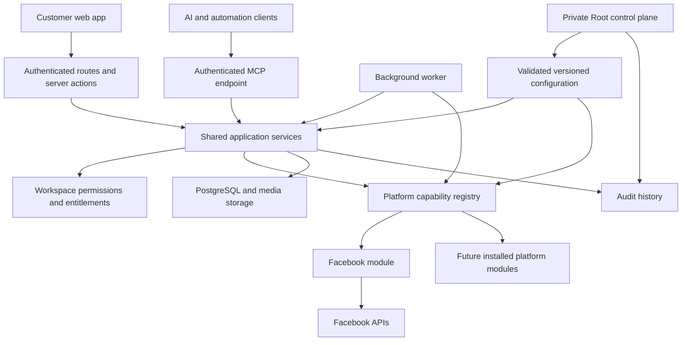

# MS Social Pilot architecture

## Authority

[ARCHITECTURE_CONTRACT.md](ARCHITECTURE_CONTRACT.md) is the mandatory target for Codex, Claude and subagents. This file describes implementation and gaps only. Follow [../../AGENTS.md](../../AGENTS.md); do not infer architecture permission from an unfinished boundary.

Updated 2026-10-16. This document distinguishes the intended production architecture from the current rebuild. A component existing in source is not proof that its complete workflow is production-ready.

## Structure

The rebuild uses Next.js App Router, React, TypeScript, Prisma, and PostgreSQL. A separate worker executes scheduled publishing and provider synchronization. UI, API, MCP, and worker entry points must converge on shared application services so that authorization and behavior do not diverge.

## Product modules

Product modules describe what a customer can do. They are independent of social networks.

| Module | Responsibility |
| --- | --- |
| Publishing | Compose, drafts, CSV import with first comments, media, approvals, queue, calendar, publishing, status refresh, and local/remote deletion |
| Inbox | Conversations and comments, replies, moderation, resolution, and synchronization |
| Analytics | Selected-channel audience totals, metric series and breakdowns, provenance, coverage, freshness, and export |
| Ads | Selected ad accounts, delivery results, object status, budgets, and supported creation/management workflows |
| Settings | Workspace connections and account selection, team permissions, account security, appearance, MCP access, and data controls |
| Root | Private installation configuration, platform availability, users, workspaces, and operational controls |

`src/modules/` contains customer module manifests. The shell derives navigation from these manifests and workspace entitlements. Root routes have separate instance-owner authorization. The current route families are `/publishing/*`, `/inbox`, `/analytics`, `/ads/*`, `/settings/*`, and `/root/*`.

The user clarified on 2026-10-16 that Root administers every product and platform module while module source remains self-contained outside Root. Current implementation is incomplete against that requirement: product manifests live under `modules/`, but much product implementation remains distributed across `app/` and `server/`; Root now has a unified module navigation/settings workflow, while module-specific operational health/actions and complete source encapsulation remain unfinished. Do not describe the current layout as complete module encapsulation or complete Root coverage.

## Platform modules

Platform modules describe how a provider fulfills a capability. Facebook is the only installed platform module. Existing Instagram source is scaffolding/legacy compatibility; it is not an enabled customer platform.

Each platform owns its manifest, settings definitions, OAuth flow, discovery, credentials/scopes, API transport and pagination, provider validation, publishing, status mapping, remote deletion, inbox behavior, analytics interpretation, Ads behavior, and background hooks. Provider UI choices and explanatory copy also belong to the module. Shared screens consume safe serializable metadata; credentials and server functions never cross to the browser.

The module registry checks installation, Root enablement, and capability support before dispatch. Unsupported operations must be omitted from the customer experience. A general `ads` or `publishing` flag alone is insufficient proof that every sub-operation exists; finer operation coverage remains necessary.

Adding a platform requires implementing and testing its module, then registering it in the installed lists and shipping a release. Root manages settings and availability of installed modules. Root cannot create a new provider implementation merely by entering an API URL.

Current locations:

- `src/platforms/<provider>/`: provider engine, settings manifest, runtime construction, OAuth state and connection/discovery flow, host assembly, jobs, Inbox and Ads implementation, metric metadata and protocol error classification.
- `src/server/platforms/`: neutral host contracts (`host.ts`), explicit installed host registration (`index.ts`), resource visibility and capability dispatch (`registry.ts`).
- `src/platforms/types.ts`: common operation contracts. Campaign objectives are opaque strings validated by each module; the Facebook enum belongs to its protocol file.

Shared analytics now consumes normalized module outputs: provider storage queries, metric interpretation and currency partitions live in the Facebook module. Inbox reply eligibility and its presentation metadata also come from the selected module; the Messenger window and its configuration read live inside Facebook. UI and MCP Inbox reads share selected-channel, workspace, permission and enabled-module filters. Media HTTP and MCP tools now share typed safe validation/storage failures; unexpected storage errors are masked. Ads service and module failures use safe typed operation errors; shared Ads HTTP routes no longer match provider messages, and MCP Ads operation calls apply the same sanitization boundary. The strict final boundary is still incomplete: other shared route error mappings name Facebook, legacy-shaped MCP reads need consolidation, and operation declarations are too coarse to prove every sub-capability. Moving files alone does not close these gaps.

## Root navigation and module settings ownership

Root sidebar groups **Shared controls**, **Product modules** and **Platform modules**. Groups are native keyboard-accessible disclosures; the current section expands automatically. Product/platform links come from installed manifests, rather than a second hardcoded catalog. `/root/modules` lists installed product modules; `/root/modules/[id]` and `/root/platforms/[id]` expose only that module's controls. Unknown/uninstalled identifiers are refused after Root authorization. The existing two-sidebar shell and mobile drawer remain the only navigation surfaces.

`lib/config/ownership.ts` assigns one owner to safe registry metadata. Platform entries declare their owner inside their adapter and take precedence over product namespaces, so the provider-owned reply window remains under its provider despite its historical key. Product manifests declare namespaces and additional legacy setting keys; module/feature availability is assigned to the declaring product automatically. Global authentication, shared worker/storage/locking policies and other shared infrastructure remain in Shared configuration. Existing key names, runtime readers, values and encrypted credentials are unchanged.

Registry version 34 exposes `owner` metadata through safe definitions (including HTTP/MCP), without saved secret values. Root module screens reuse the existing validated/audited setting service and scoped form. Product availability/feature controls appear first; provider categories omit the repeated provider group prefix. Search/categories live in the contextual sidebar and cannot return unrelated module controls. Module form state remounts by owner when switching modules. Store failures keep navigation/recovery available; declared adapter operations are explicitly distinct from live-provider health or complete coverage.

This implements module menu/settings organization, not the full module-management end state: per-module health/actions, missing operator workflows, every technical configuration consumer and full product implementation encapsulation still require work.

## Connection and data lifecycle

1. An authorized member starts a connection for an available platform.
2. Server-bound OAuth state ties the callback to the user and workspace.
3. The platform discovers channels and ad accounts. Tokens remain encrypted server-side.
4. A selection modal shows discovered resources with checkboxes. Only selected resources become active product resources; users can revise the selection later.
5. Shared workflows resolve each resource's provider and invoke its enabled capability host.
6. Disconnect asks whether related app data should be retained or deleted. Local post deletion separately offers remote deletion when a remote publication exists.

Workspace is the tenant boundary. Connections own discovered channels and ad accounts; posts have per-channel delivery records and remote IDs; conversations/comments, insight records, media, and job records link back to workspace-owned resources. Existing production tables are currently accessed through a partial Prisma compatibility view. This is not yet a clean final persistence model or an approved production migration schema.

## Authorization and MCP

Every customer workspace operation must enforce authenticated identity, workspace membership, feature entitlement, feature read/write permissions, resource/channel scope, platform availability, and operation-specific provider grants. Private Root operations instead require current installation-owner authority and do not inherit workspace privileges. Client-side hiding is only presentation; mutation services repeat server-side checks.

MCP is served at `/api/mcp`. It supports authenticated workspace access, scoped API keys, tools/resources, confirmations for writes, and audit records. It calls the same application services as the web app wherever those services exist. Root MCP access is restricted separately; workspace API keys cannot gain installation-owner privileges. Full UI/API/MCP parity is still incomplete and must be verified capability by capability. All tool calls now expose only deliberate `OperationError` messages/codes; unexpected failures are masked at the shared MCP response boundary. Resource failures carry the same safe code in JSON-RPC `error.data`. Publishing, Inbox, connection selection and data-control validation/access failures use typed public errors, while raw database/provider/storage exceptions remain untrusted. Unknown write failures tell clients to check current state before repeating. Secondary MCP audit failures preserve returned service outcomes with `mcpAuditRecorded: false` and an explicit warning rather than falsely reporting action failure. Domain audits, remote-success/local-persistence uncertainty and durable reconciliation still require operation-specific guarantees; this boundary is not proof of exactly-once delivery or complete audit durability.

Private Root workspace access uses `server/root/workspace-access.ts` for UI API and MCP. It rechecks current installation-owner authority and disabled-account state, takes an exclusive workspace row lock, refuses active data purges, requires an exact stable-ID action confirmation and commits the state change with its audit entry. The legacy `suspendedAt` column is accessed through bounded compatibility SQL; no schema migration was applied. Shared workspace operations take a compatible shared row lock and refuse a suspended workspace before side effects. Provider background sync now uses that same lock across network retries and storage. In-flight work finishes before suspension commits. Ordinary customer entitlements are denied; private installation-owner inspection and restoration remain possible.

The new Root MCP tools are `list_root_workspaces` and `set_root_workspace_access`, with `msp://root/workspaces`. Reads use the smaller configured Root directory and MCP result limits. These tools have typed public errors and redact unexpected failures; workspace API keys cannot list or invoke them. Root operations deliberately bypass the ordinary shared workspace operation wrapper to avoid upgrading a held shared lock to exclusive and to permit restoration. The HTTP MCP authentication path now supports a distinct installation identity without workspace membership; see the context rules below.

Private Root audit history now uses `server/root/activity.ts`. UI `/root/activity`, HTTP `/api/root/activity`, MCP `list_root_activity` and resource `msp://root/activity` share a service that rechecks current installation-owner/disabled state before any audit query. Action/person substring search is literal and SQL-bound; exact workspace filtering matches top-level `detail.workspaceId` only. UTC date endpoints are inclusive; the SQL upper bound is the following midnight. Validated date text is cast to PostgreSQL date; cursor anchors bind canonical ISO text with explicit timestamp casts so comparisons to legacy UTC `TIMESTAMP(3)` storage do not depend on the session timezone. Tuple cursors order by that millisecond timestamp and stable ID, bind to normalized filters and support nearest-newer/older navigation without offset drift from new events. The response contains the existing allowlisted metadata projection, never raw audit payloads. Cursor tokens are seek positions, not authorization grants.

Operational audit page, search and encoded cursor bounds are validated Root settings. The only fixed cursor invariants are its version, canonical base64url JSON shape, SHA-256 filter digest and timestamp precision matching `TIMESTAMP(3)`. This adds no DDL. Substring/workspace queries still need production-volume plan/load evidence and possible reviewed indexes; exports, raw-detail inspection, retention and generic log/error administration are not implemented by this read surface. Private MCP context authentication is now independent of membership as described below.

MCP identities are discriminated as workspace or installation in `server/mcp/types.ts`. `?scope=installation` accepts only a fully verified active installation-owner session, does not load workspace grants, and exposes only private Root tools/resources. `?scope=workspace` requires actual membership, current grants and a permitted workspace role, and does not expose Root privileges even to an installation owner. Without an explicit scope, current workspace behavior remains; an owner falls back to private installation context when membership/role/grants are absent. A supplied bearer always controls authentication and never falls back to a browser cookie; workspace keys cannot enter installation context. Workspace keys and explicit workspace context also disable the installation-owner suspension-inspection exception in `loadEntitlements`; a key does not inherit that privilege from its creator. Invalid/repeated scope values are rejected. Global MCP availability and configured limits still apply, with a per-owner installation rate key and no fabricated workspace ID/entitlements.

`server/mcp/root-tools.ts` owns private definitions, resources and the shared dispatcher for both session contexts. Every Root operation rechecks current account/owner state before services; all its unexpected failures are masked. Configuration input is checked against the same typed registry and exact confirmation, then `saveConfig` commits its setting and value-free audit atomically. The former independent post-save MCP audit was removed for this operation so a secondary audit failure cannot misreport a committed change as failed. Workspace access retains its own transactional audit. HTTP authentication/transport responses and protocol replies use `no-store`. Root overview contains private session-connection guidance; a membership-free owner encountering `/no-workspace` recovers to `/root`. Customer empty states retain invitation/sign-out recovery without private setup copy.

Installation-scoped bearer issuance/OAuth is not implemented; the private context currently requires a verified browser session. This closes the membership dependency for existing Root operations, not all Root UI/API/MCP capability parity. The shared MCP unexpected-error boundary is implemented; durable domain auditing/reconciliation and the complete operator inventory remain open.

## Root user directory and account controls

Private Users UI, HTTP `GET /api/root/users`, MCP `list_root_users` and resource `msp://root/users` share `server/root/users.ts`. Current active Root authority is required before reading names/emails, access state, membership/factor counts or active verified session counts. Search is literal (PostgreSQL wildcard characters escaped), bounded by the registry and combined with all/active/disabled/owners status. Pagination is bounded and stale pages clamp to the matching count; credentials, factor material and session identifiers are excluded.

HTTP account actions and MCP `manage_root_user` share `root/user-controls.ts`. Serializable transactions lock actor/target user rows in stable order, recheck current active installation authority and target state, require shared exact confirmations, preserve self/last-owner/owner-factor-reset guards and commit local changes/session revocation/domain audit together. Serialization conflicts request a reload; unexpected failures are masked. Workspace API keys cannot reach these operations. Sign out changes browser sessions, not workspace API keys; disabling the creator separately blocks key authentication through current-user checks.

User filters and pagination live in the contextual sidebar. Dialogs retain confirmation/error input, prevent duplicate submits, and require a matching HTTP receipt before showing success and refreshing. Unknown results ask operators to inspect state/activity first. Registry version 33 manages user-search and account transaction bounds. User deletion, privilege assignment, plans and complete per-module operations/health remain incomplete.

## Configuration

The typed configuration registry supplies schemas, defaults, groups, safe display metadata, and a schema version. Runtime reads validate persisted values. Root writes validate changes and save audit history transactionally. Secrets are encrypted and omitted from ordinary configuration reads.

The required final coverage includes platform settings, endpoints/scopes, limits, schedules, permissions, entitlements, branding/themes, retention, logging, jobs, and MCP. Some registered options are still marked planned, and not all current literals are registry-backed. Therefore the requirement that Root manages every operational option is not complete.

Bootstrap trust remains outside ordinary Root editing: database access and encryption-key material must be available before Root can read configuration. Provider protocol constants belong inside adapters, documented separately from configurable policy.

## Design and UX

One shell, semantic design tokens, shared components, and selectable Grove, Coast, Clay, and Nightfall themes serve every module. `DESIGN.md` records the visual system; `UX-CONTRACT.md` records behavior. Navigation, filters, and resource selection share the sidebar. Responsive layouts, keyboard focus, validation, loading/error/empty states, confirmations, and permission-sensitive actions must behave consistently across screens. The design foundation exists; complete browser verification and polish are still release gates.

The user approved core design first on 2026-10-16. The shell now has a narrow module rail and contextual sidebar, permission-aware New post action, membership-backed workspace switching, and one contextual drawer on narrower screens. `SidebarDock` places route-local Root configuration search/categories into that same sidebar. Posts defaults to Table and offers Feed/Cards using one scoped paginated query and existing action controls; the neutral preview includes stored text, media/link references, first comments and destination outcomes. A separate private Root manifest generates Overview, Operations, Activity and installation navigation. Overview uses actual counts; activity reads bounded, redacted audit history with sidebar search, UTC date/workspace filters and tuple cursor pagination; worker health distinguishes unavailable telemetry from missing replacement-worker heartbeats. The next publishing batch adds a recoverable dedicated composer, shared full previews in queue/approvals and calendar dialogs, server-resolved workspace time presentation and guarded synthetic image examples. Transport failures retain composer state and distinguish an unconfirmed save from a confirmed failure. This is continuing core design work, not complete core or Root parity. Follow [CORE_DESIGN_PLAN.md](CORE_DESIGN_PLAN.md) before adding further Facebook operations.

## Jobs and release safety

The worker dispatches shared publishing and module-owned synchronization with job leases, run history, retries, and configured schedules. Production cutover must prevent the legacy and rebuild workers from publishing the same queue.

The legacy app remains the production service. The existing `socialpilot-deploy` command still targets legacy. A rebuild cutover needs an exact release, needed-data migration, media verification, functional and authorization checks, real provider and MCP tests, a restorable backup, and a rehearsed proxy/service rollback. `docs/CUTOVER.md` records the current blockers. No production-ready or deployment claim follows from a passing build alone.

## Verified progress and remaining scope

Shared Ads dispatches by selected-account provider, uses module-owned creation metadata, and enforces current resource scope in services and lists. Shared analytics loading and aggregation consume neutral metric/audience inputs; the enabled Facebook host owns storage reads and semantics. Monetary series are separated by currency, ratios derive from source totals, unknown numeric measures use snapshots, and duplicate retained fields are not double-counted. The current integrated suite passed 503 tests, including both rollback-only PostgreSQL delivery and Inbox audit probes against the dedicated synthetic preview database. Current TypeScript checking and an isolated production build passed. Ads HTTP routes and all MCP Ads tools now share safe typed failure handling, including creation metadata; resource-read failures return safe JSON-RPC errors. Ads mutations accept exactly one status or budget change, and MCP no longer coerces string budgets. Shared selected-resource visibility now feeds channel reads, Home, Ads account lists and MCP destinations; enabling a selection checks module availability and credential health. Inbox policy is dispatched through platform hosts and UI/MCP Inbox selection filters are shared. Connection status copy is managed by Root. Shared native dialogs now recover focus after failures and retain failed Inbox deletion context; targeted Chrome checks cover Ads/Inbox recovery and keyboard behavior. A dedicated synthetic browser preview now exists; [PREVIEW_QA.md](PREVIEW_QA.md) records checked sample workflows and remaining findings. Full browser and live-provider verification are separate release gates.

Remaining work includes shared route/MCP cleanup, granular capability declarations, full metric/provider-operation coverage beyond the current stored account-level Analytics inputs, complete Facebook media and Ads lifecycles, legacy capability parity, comprehensive Root configuration coverage, complete MCP parity, design/browser checks, production-shaped data/permission checks, live provider verification and cleanup, migration/rollback rehearsal, and rebuild deployment.

## Root diagnostics and module operations — 2026-10-16

`server/root/diagnostics.ts` is the private shared UI/HTTP/MCP service. `/root/operations` contains Shared infrastructure checks; each installed product/platform settings screen contains its own diagnostic history, safe results and sidebar run controls. Scope IDs derive from installed manifests. Provider connection choices are bounded to the chosen platform, and exact IDs can be tested through HTTP/MCP. Root may test installed platforms before enabling customer access. No arbitrary URL, script, tool name or provider write is accepted.

The service rechecks active installation authority, requires `RUN DIAGNOSTICS <scope>`, acquires a PostgreSQL advisory transaction lock per scope and records a start before preparing checks. Cooldown spans owners, interfaces and connection choices. Unconfirmed starts block retries until recovery; each start retains a recovery floor at least its original total deadline plus two database timeouts, so later shorter settings cannot permit early overlap. A total preparation/check deadline cancels provider requests, marks the active check failed and skips remaining checks. Database probes/audit transactions have separate statement/transaction bounds; not all background read promises are cancellable at the database driver. Returned outcomes are preserved with a warning if completion auditing fails. History retains started-but-unconfirmed runs explicitly; it does not label them successful.

`server/diagnostics/checks.ts` owns neutral configuration validation, database reads, in-memory authenticated encryption, media-directory permission checks and replacement worker activity. Product checks validate only their owned configuration and job evidence. `platforms/facebook/diagnostics.ts` owns OAuth setting presence, selected-source expiry/revocation, authenticated identity comparison, current requested grants and read-only Page/ad-account discovery. These checks reuse the configured adapter transport, combined per-request/suite cancellation and pagination limits; they neither persist discovery nor change provider data. Success counts only the returned bounded discovery set. A pass is not proof of callback registration, every selected resource, publishing, media, inbox delivery or spend-changing access. Preview credentials/endpoints are synthetic and deliberately fail remote reads.

Product manifests now declare background job names, labels and schedule keys, shared by the worker and Root health. The Root-managed `jobs.order` preserves the previous dispatch priority by default; unlisted installed jobs follow in manifest order. `root/operations.ts` reads replacement-only run history and heartbeats in the persisted `rebuild-` identity namespace, projects enum outcomes/timestamps/durations/error-presence and omits stored raw errors, summaries and hostnames. It never interprets shared jobs as provider-specific telemetry. UI/API/MCP use this same current-Root-checked service. No-job modules say checks are skipped rather than inventing worker evidence. The old mixed legacy/rebuild latest-job read has been removed.

Registry version 35 supplies diagnostics availability, cooldown, incomplete-run recovery, total check deadline, database timeout, bounded history, operational timezone and recent-run/stale-heartbeat controls. Explicit timezone formatting avoids server/browser hydration disagreement; ISO HTTP/MCP timestamps remain UTC. Other Root date screens have not all adopted this preference. Private MCP now has ten tools/six resources, including operations and diagnostics. Workspace bearer keys remain excluded.

This batch adds no application migration. The existing worker migration was missing from the isolated preview; it was applied there only after a local custom-format backup was restored and aggregate fixture counts matched. No worker was started and no production service or schema changed. Full platform-operation diagnostics, remote live-provider evidence, broader legacy operator controls, product encapsulation and production cutover gates remain unfinished.

## Inbox stored activity browsing — 2026-10-16

Inbox list/thread reads now live in `modules/inbox/server`, shared by the page, new no-store HTTP read routes and MCP `list_inbox`/`get_inbox_thread`. The former duplicate overview and MCP ORM lists were removed. Services recheck current active account, membership, entitlement, feature permission, workspace state and selected Inbox-capable channel visibility; key limits intersect current member grants. The Inbox shell now explicitly accepts this scoped reader path. Stable filter-bound tuple cursors support both directions, literal message/person search and separate history continuation without old 50-per-type/300-history truncation. Latest inbound reply eligibility is independent of the shown window. Counts and coverage copy say stored activity.

Registry version 36 adds Inbox-owned page/search/cursor bounds consumed by services and sidebar controls. The UI preserves list position, history position and selected conversation where valid, with distinct reset/empty/error states. A guarded synthetic 54-message fixture supports local browsing checks. No migration or remote provider operation is part of this batch. See PREVIEW_QA for evidence and remaining UX/provider/MCP gaps.

## Shared form behavior — 2026-10-16

The design layer now owns reusable field validation/focus (`components/FormValidation.tsx` over `lib/ui/form-validation.ts`) and multiline behavior (`components/AutoTextarea.tsx`). These helpers contain no provider branching or server authorization policy. Mutation forms use native metadata plus explicit domain checks; server/API services remain authoritative. Existing GET/action entry points declare server-owned validation rather than browser message bubbles. Form control changes do not add configuration, persistence schema or provider operations. Account password checks retain the provided UTF-8 byte policy; one-time MCP token display defaults to masked with explicit reveal/copy. Current verification and open cross-screen/browser limitations are in PREVIEW_QA.

## Inbox local workflow and write boundaries — 2026-10-16

`modules/inbox/server/access.ts` now owns shared current-identity/feature/channel authorization for reads and local workflow. `workflow.ts` owns validated resolve/reopen with a scoped update and matching legacy-named domain audit in one database transaction. This product-local operation no longer belongs to the Facebook host or requires live provider credentials. UI exposes local workflow independently of remote reply/moderation readiness; HTTP and MCP share the service, and MCP intersects its caller channel constraint. Only the service acquires the workspace operation lock, and it refreshes grants after the lock wait before opening the local mutation transaction. HTTP/MCP transport wrappers explicitly skip their generic lock for this operation, avoiding a nested-lock queue deadlock against purge/suspension.

Inbox action HTTP now masks unexpected errors through the shared typed boundary and returns no-store for all outcomes. Non-sync service receipts must explicitly confirm success. The client refuses malformed/missing/false receipts, validates displayed sync counts/timestamps and retains text/dialog context with honest unconfirmed-outcome copy. These are safety boundaries, not a durable remote operation journal. Required remote-deletion recovery, sync tombstones/concurrency, lifecycle integration and MCP deletion are detailed in INBOX_WRITE_RECOVERY.md and remain unfinished. No schema change was introduced.

Registry 37 adds Inbox-owned local transaction duration/acquisition bounds consumed by resolve/reopen; existing Shared controls still govern its workspace lock. No provider protocol timing is introduced into shared product logic.
